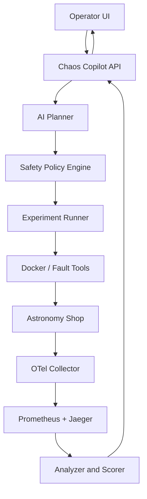
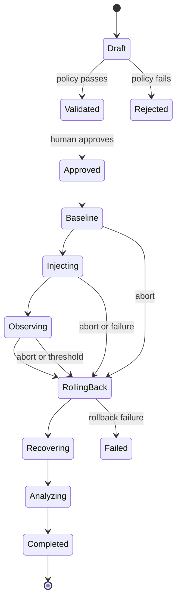

# Product Requirements Document: Chaos Copilot

**Status:** MVP approved for hackathon implementation  
**Target application:** OpenTelemetry Astronomy Shop  
**Runtime:** Docker Compose  
**Document version:** 1.0  
**Date:** 10 October 2026

## 1. Product summary

Chaos Copilot is an AI-assisted chaos-engineering platform that discovers the topology of the OpenTelemetry Astronomy Shop, proposes a safe resilience experiment, executes the approved fault inside the local Docker Compose sandbox, observes application behavior through OpenTelemetry data, restores the system, and produces a ranked findings report with evidence and remediation suggestions.

The OpenTelemetry Demo is the **system under test**, not the product being built. The hackathon deliverable is the orchestration, safety, observation, analysis, and reporting layer added around the demo.

### One-sentence pitch

> Chaos Copilot turns an observable microservice application into a safely testable resilience lab: AI chooses useful experiments, deterministic policy constrains them, and telemetry proves what happened.

## 2. Why cloning and running Astronomy Shop was required

The cloned application provides:

- a real containerized, multi-service system;
- HTTP, gRPC, database, cache, and asynchronous dependencies;
- realistic shopping journeys and a built-in Locust load generator;
- traces, metrics, and logs exposed through OpenTelemetry;
- Jaeger, Prometheus, and Grafana for observable evidence;
- a local sandbox where failures can be injected without affecting production.

Getting it running completes the first prerequisite. It does not complete the project.

## 3. Problem statement

Teams can deploy observable microservices but often do not know:

1. which dependency is most useful to test;
2. which failure is safe and informative;
3. whether the system degraded gracefully;
4. how quickly it recovered;
5. which resilience weakness should be fixed first.

Manual chaos experiments are slow to design, easy to run unsafely, and difficult to evaluate consistently. Chaos Copilot reduces that work while keeping execution under deterministic controls.

## 4. Goals

### MVP goals

1. Discover or construct a service dependency map for Astronomy Shop.
2. Capture a healthy baseline for selected user journeys.
3. Use an LLM to propose an experiment as structured JSON.
4. Validate every proposal through a deterministic safety policy.
5. Require explicit human approval before fault injection.
6. Support at least three failure types:
   - container crash;
   - network latency and/or packet loss;
   - dependency failure or pause.
7. Run load before, during, and after each experiment.
8. Measure impact and recovery using Prometheus and/or Jaeger data.
9. Automatically roll back every injected fault.
10. Provide a global emergency stop control.
11. Generate a findings report with evidence, ranking, resilience score, and suggested fixes.
12. Demonstrate the complete loop in under three minutes.

### Stretch goals

- CPU or memory stress.
- Database overload using a bounded workload.
- Traffic spike experiment.
- Combined failure experiment.
- Re-run an experiment after a resilience fix and compare scores.
- Kubernetes executor for kind or minikube.
- Live service graph enriched from traces.

## 5. Non-goals

- Building or modifying the business logic of Astronomy Shop.
- Replacing Jaeger, Prometheus, Grafana, or OpenTelemetry Collector.
- Letting an LLM execute shell commands directly.
- Attacking production, shared infrastructure, the host OS, or external systems.
- Supporting every chaos tool or orchestration platform.
- Automatic code changes to target services in the MVP.
- A fully autonomous, approval-free chaos platform.

## 6. Users

### Primary user

A developer or SRE running Astronomy Shop locally who wants to identify resilience weaknesses quickly and safely.

### User needs

- See whether the target system is ready for an experiment.
- Understand the proposed hypothesis and expected blast radius.
- Approve or reject an experiment.
- Watch the fault and its measured effects.
- Stop the experiment immediately.
- Receive clear, evidence-backed findings and recommended fixes.

## 7. Product principles

1. **AI proposes; policy decides; a human approves.**
2. **No experiment without a rollback path.**
3. **No finding without telemetry evidence.**
4. **Bound the blast radius before execution.**
5. **Degrade the application, not the observability or control plane.**
6. **Prefer one clear, repeatable experiment over many unreliable features.**

## 8. Recommended implementation model

Implement Chaos Copilot in the same fork as Astronomy Shop, but keep it isolated from the demo's application services.

Use the upstream `compose.extras.yaml` extension point to add Chaos Copilot services or local configuration. Do not edit the source code of Astronomy Shop services for the MVP.

Suggested repository layout:

```text
opentelemetry-demo/
├── compose.yaml
├── compose.full.yaml
├── compose.observability.yaml
├── compose.extras.yaml
├── chaos-copilot/
│   ├── backend/
│   │   ├── app/
│   │   │   ├── api/
│   │   │   ├── discovery/
│   │   │   ├── planner/
│   │   │   ├── policy/
│   │   │   ├── executors/
│   │   │   ├── observers/
│   │   │   ├── scoring/
│   │   │   ├── reports/
│   │   │   └── main.py
│   │   ├── tests/
│   │   ├── Dockerfile
│   │   └── pyproject.toml
│   ├── frontend/
│   ├── config/
│   │   ├── safety-policy.yaml
│   │   ├── journeys.yaml
│   │   └── service-overrides.yaml
│   ├── experiments/
│   ├── reports/
│   └── README.md
└── docs/
    ├── architecture.md
    └── demo-script.md
```

## 9. System architecture



### Component responsibilities

| Component | Responsibility |
| --- | --- |
| Operator UI | Readiness, topology, proposal, approval, live state, stop, and report |
| FastAPI backend | API, experiment state machine, persistence, and component coordination |
| Topology discovery | Parse Compose configuration and enrich dependencies from traces |
| AI planner | Select target, failure type, hypothesis, metrics, and likely remediation |
| Policy engine | Reject unsafe, malformed, excessive, or unsupported plans |
| Experiment runner | Baseline, inject, observe, abort/rollback, recover, analyze |
| Docker executor | Stop, kill, pause, unpause, restart, and inspect allowlisted containers |
| Network executor | Apply and remove bounded latency/loss through a controlled tool such as Pumba/netem |
| Load controller | Start or configure the existing Locust load generator |
| Telemetry adapters | Query Prometheus and Jaeger using their HTTP APIs |
| Analyzer/scorer | Compare baseline, fault, and recovery windows |
| Report generator | Produce Markdown/JSON findings and remediation advice |

## 10. Core user flow

1. User opens Chaos Copilot.
2. System runs readiness checks:
   - Docker reachable;
   - target Compose project detected;
   - required services healthy;
   - Prometheus and Jaeger reachable;
   - no active experiment.
3. System displays the dependency map and protected services.
4. User selects a goal, such as “test graceful degradation” or “find a critical dependency.”
5. AI planner returns one structured experiment proposal.
6. Policy engine shows validation results and calculated blast radius.
7. User approves the experiment.
8. System records a baseline under synthetic load.
9. System injects the bounded fault.
10. UI shows elapsed time, active fault, key metrics, and STOP control.
11. System rolls back automatically, even if observation or analysis fails.
12. System waits for recovery and validates health.
13. System generates a scored finding with evidence and remediation.

## 11. Experiment state machine



Only one experiment may be active at a time in the MVP.

## 12. Functional requirements

### FR-1: Target discovery and readiness

The system must:

- identify containers belonging to the configured Compose project;
- read service names, container IDs, health, labels, networks, and dependencies;
- distinguish application, datastore, observability, load, and control-plane services;
- display protected services that cannot be targeted;
- refuse experiments if the target system or rollback mechanism is not ready.

**Acceptance criteria**

- At least 90% of enabled Compose services appear in the topology inventory.
- Each service is assigned a type and protection status.
- Readiness returns a clear pass/fail reason for every check.

### FR-2: Dependency map

The system must build an initial graph from Compose configuration. Runtime Jaeger traces may enrich or correct edges.

Each node should contain:

- service name;
- container name or ID;
- role;
- health;
- stateful/stateless classification;
- protected/unprotected status;
- criticality score.

Manual overrides are permitted through `service-overrides.yaml`.

**Acceptance criteria**

- The graph contains frontend, key downstream services, database/cache, and observability components.
- The user can inspect why a service is considered critical or protected.

### FR-3: Business journeys

Define at least three journeys:

| Journey | Expected result |
| --- | --- |
| Browse catalog | Product list loads successfully |
| View recommendations | Recommendation content loads or degrades gracefully |
| Add to cart / checkout | Cart and checkout requests complete successfully |

The existing Locust workload should be reused where possible.

### FR-4: Baseline collection

Before fault injection, the system must collect a baseline under a repeatable load profile.

Default MVP timings:

- warm-up: 30 seconds;
- measured baseline: 60 seconds;
- fault window: 30 seconds;
- recovery timeout: 60 seconds.

Timings must be configurable within policy bounds.

Collect:

- request or span success rate;
- error rate;
- p50 and p95 latency;
- request throughput;
- affected services;
- health status;
- recovery time;
- business journey success.

### FR-5: AI experiment planner

The planner must receive:

- service graph;
- current health;
- baseline summary;
- supported failure types;
- safety policy;
- previous experiment summaries;
- chosen test goal.

The LLM must return JSON conforming to the schema below. It must never return executable commands.

```json
{
  "title": "Recommendation service crash",
  "goal": "Test whether product browsing survives recommendation failure",
  "hypothesis": "Core browsing remains available while recommendations fail gracefully",
  "target_service": "recommendation",
  "failure_type": "CONTAINER_KILL",
  "parameters": {
    "duration_seconds": 30,
    "signal": "SIGKILL"
  },
  "expected_impact": [
    "recommendation requests fail",
    "catalog browsing remains available"
  ],
  "observe": [
    "frontend error rate",
    "frontend p95 latency",
    "recommendation span errors",
    "recovery time"
  ],
  "reasoning_summary": "Recommendation is user-visible but should not be required for the core catalog journey."
}
```

**Acceptance criteria**

- Invalid LLM output is rejected by schema validation.
- The planner chooses only services and fault types supplied in its context.
- The UI clearly labels AI-generated reasoning as advisory.

### FR-6: Deterministic safety policy

The safety engine is authoritative and must not use an LLM for final approval.

Default policy:

```yaml
max_concurrent_experiments: 1
max_targets_per_experiment: 1
max_fault_duration_seconds: 60
max_network_delay_ms: 1000
max_packet_loss_percent: 40
require_manual_approval: true
require_rollback_action: true
allow_host_faults: false
allow_disk_fill: false
protected_services:
  - chaos-copilot
  - otel-collector
  - prometheus
  - jaeger
  - grafana
  - opensearch
  - load-generator
allowed_failure_types:
  - CONTAINER_KILL
  - CONTAINER_PAUSE
  - NETWORK_DELAY
  - NETWORK_LOSS
  - TRAFFIC_SPIKE
```

Safety checks must include:

- exact service allowlist;
- protected service denylist;
- maximum duration and severity;
- single target and single active experiment;
- rollback implementation available;
- Docker target belongs to the expected Compose project;
- observability/control plane remains reachable;
- explicit approval token is valid;
- automatic abort thresholds are configured.

### FR-7: Fault execution

#### Required MVP fault types

1. **CONTAINER_KILL**
   - Kill one allowlisted application container.
   - Rollback by starting or recreating the service.

2. **CONTAINER_PAUSE**
   - Pause one allowlisted application container.
   - Rollback by unpausing it.

3. **NETWORK_DELAY**
   - Add 100–1000 ms delay to one allowlisted service for a bounded duration.
   - Rollback must remove the network rule.

4. **NETWORK_LOSS**
   - Add 1–40% packet loss to one allowlisted service for a bounded duration.
   - Rollback must remove the network rule.

5. **TRAFFIC_SPIKE**
   - Increase Locust user count within a configured ceiling.
   - Rollback returns load to baseline.

Only three distinct failure types are required for the hackathon MVP, but interfaces should allow the remaining types to be added without redesign.

#### Executor contract

Every executor must implement:

```python
class FaultExecutor(Protocol):
    def validate(self, experiment: Experiment) -> ValidationResult: ...
    def inject(self, experiment: Experiment) -> FaultHandle: ...
    def verify_active(self, handle: FaultHandle) -> bool: ...
    def rollback(self, handle: FaultHandle) -> RollbackResult: ...
    def verify_recovered(self, handle: FaultHandle) -> bool: ...
```

`rollback()` must be idempotent.

### FR-8: Kill switch and automatic abort

The UI must show a persistent STOP button whenever an experiment is in Baseline, Injecting, Observing, or Recovering state.

STOP must:

1. prevent further injections;
2. cancel active timers/tasks;
3. invoke rollback for every active fault handle;
4. restore load to its baseline configuration;
5. record the abort reason;
6. verify recovery and show any manual recovery steps.

Automatic abort should trigger when any configured condition persists across two observation intervals:

- core journey availability below 70%;
- frontend error rate above 50%;
- observability backend unavailable;
- unexpected second target affected;
- executor heartbeat lost;
- fault duration exceeds policy.

Application shutdown, API shutdown, and unexpected exceptions must also invoke best-effort rollback.

### FR-9: Telemetry observation

Prometheus is the primary source for numeric time-series metrics. Jaeger is the primary source for trace and dependency evidence.

The system must use explicit time windows:

- baseline window;
- fault window;
- recovery window.

All measurements saved in a report must include source, query/operation, unit, aggregation, and time range.

If a required query returns no data, the UI must say “No data” rather than treating it as zero.

### FR-10: Analysis and scoring

For each experiment, calculate:

```text
error_impact       = clamp((fault_error_rate - baseline_error_rate) / 1.0, 0, 1)
latency_impact     = clamp((fault_p95 / max(baseline_p95, epsilon) - 1) / 4, 0, 1)
availability_loss = clamp(baseline_availability - fault_availability, 0, 1)
recovery_impact    = clamp(recovery_seconds / recovery_timeout_seconds, 0, 1)

impact_score = 100 * (
    0.35 * error_impact +
    0.25 * latency_impact +
    0.20 * availability_loss +
    0.20 * recovery_impact
)

resilience_score = round(100 - impact_score)
```

This score measures behavior in the tested scenario; it is not a universal reliability rating.

Severity:

| Impact score | Severity |
| --- | --- |
| 0–19 | Low |
| 20–39 | Moderate |
| 40–69 | High |
| 70–100 | Critical |

The report must separate deterministic observations from AI-generated interpretation.

### FR-11: Findings and remediation report

Each completed experiment must produce Markdown and JSON containing:

- experiment ID and timestamp;
- target app commit SHA;
- hypothesis;
- approved plan and policy decision;
- baseline configuration;
- fault details and exact duration;
- rollback and recovery result;
- baseline/fault/recovery metric comparison;
- affected journeys and services;
- impact and resilience scores;
- evidence links or query details;
- likely cause;
- ranked remediation suggestions;
- limitations or missing telemetry.

Findings across experiments should be ranked by severity, affected criticality, and confidence.

### FR-12: Audit log

Record append-only events for:

- proposal created;
- validation passed or failed;
- approval granted or denied;
- baseline started/completed;
- fault injected/verified;
- automatic or manual abort;
- rollback invoked/completed/failed;
- recovery detected;
- report generated.

Never store LLM/API secrets in the audit log.

## 13. Initial experiment catalogue

Build and demo these experiments in this order:

### Experiment 1: Recommendation service crash

- **Target:** `recommendation`
- **Fault:** container kill for 30 seconds
- **Hypothesis:** core catalog browsing remains usable; recommendation-specific calls fail or degrade gracefully
- **Value:** easy to understand, visually demonstrable, and lower risk than a database failure

### Experiment 2: Product catalog network degradation

- **Target:** `product-catalog`
- **Fault:** 400 ms delay, then optionally 15% loss, for 30 seconds
- **Hypothesis:** frontend latency increases and dependent calls expose missing timeout/retry behavior
- **Value:** demonstrates slow/lossy network, distributed tracing, and blast-radius analysis

### Experiment 3: Cart cache dependency failure

- **Target:** `valkey-cart`
- **Fault:** container pause for 30 seconds
- **Hypothesis:** add-to-cart fails while browse-only journeys remain available
- **Value:** demonstrates a stateful dependency failure and journey-level impact

### Optional Experiment 4: Traffic spike

- **Target:** frontend/application stack
- **Fault:** bounded Locust user increase
- **Hypothesis:** p95 latency grows before errors, revealing the first saturated dependency

Do not use full disk as an MVP experiment. It is more difficult to contain and clean up safely on a hackathon laptop.

## 14. API requirements

Minimum REST API:

| Method | Endpoint | Purpose |
| --- | --- | --- |
| GET | `/api/health` | Chaos Copilot health |
| GET | `/api/readiness` | Target and safety readiness checks |
| GET | `/api/topology` | Service graph and protection metadata |
| POST | `/api/baselines` | Run or refresh a baseline |
| GET | `/api/baselines/latest` | Latest baseline summary |
| POST | `/api/experiments/propose` | Request one AI-generated proposal |
| POST | `/api/experiments/{id}/validate` | Run deterministic safety validation |
| POST | `/api/experiments/{id}/approve` | Record human approval and start |
| POST | `/api/experiments/{id}/abort` | Emergency stop and rollback |
| GET | `/api/experiments/{id}` | Status, phase, timing, and live observations |
| GET | `/api/experiments/{id}/events` | Server-sent events for live UI updates |
| GET | `/api/reports/{id}` | Completed report |
| GET | `/api/findings` | Ranked findings across experiments |

Mutating endpoints should accept an idempotency key.

## 15. Data model

Use SQLite for the MVP.

Minimum entities:

- `ServiceNode`
- `DependencyEdge`
- `BaselineRun`
- `Experiment`
- `PolicyDecision`
- `Approval`
- `FaultHandle`
- `Observation`
- `AuditEvent`
- `Finding`
- `Report`

Experiment fields must include target app commit SHA, state, timestamps, proposal JSON, normalized parameters, policy result, approval identity/name, rollback status, abort reason, and final score.

## 16. UI requirements

One screen is sufficient for the MVP, divided into:

1. **Readiness bar** — target, telemetry, Docker, and safety status.
2. **Topology panel** — services, edges, health, criticality, protected badges.
3. **Experiment proposal** — goal, target, failure, hypothesis, blast radius, parameters.
4. **Policy panel** — passed/failed checks and approval button.
5. **Live run panel** — phase, timer, baseline versus live metrics, active fault, STOP button.
6. **Result panel** — impact, recovery, score, evidence, and recommended fixes.

Streamlit is acceptable for speed. React is optional and should not delay the experiment engine.

## 17. Technology choices

| Concern | MVP choice |
| --- | --- |
| Backend | Python 3.12 + FastAPI |
| Validation | Pydantic v2 |
| Persistence | SQLite + SQLModel or SQLAlchemy |
| Container control | Docker Python SDK |
| Network faults | Pumba/netem invoked through a fixed adapter, never free-form LLM commands |
| Graph analysis | NetworkX |
| Metrics | Prometheus HTTP API |
| Traces | Jaeger HTTP API |
| Load | Existing Astronomy Shop Locust service |
| UI | Streamlit for MVP |
| AI provider | Provider-neutral interface with one configured implementation |
| Tests | pytest + mocked Docker/Prometheus/Jaeger adapters |

The backend should run on the host during initial development because Docker control is simpler. Containerize it after the core executor and rollback paths work. If containerized, mount the Docker socket read/write only for the hackathon sandbox and document the security risk.

## 18. Security and safety requirements

- Bind the Chaos Copilot UI/API to localhost by default.
- Never accept raw commands from the UI or LLM.
- Do not expose or log environment secrets.
- Use exact service identifiers, not partial matching.
- Verify Compose project labels immediately before every mutation.
- Protect the observability stack and Chaos Copilot itself.
- Use `try/finally` around every active experiment.
- Persist fault handles before injection returns success.
- Make rollback idempotent and callable after process restart where practical.
- Do not run privileged host-level faults.
- Display a warning if Docker socket access is enabled.
- Save the target repository commit SHA in every run.

## 19. Reliability requirements for Chaos Copilot

- A planner outage must not affect Astronomy Shop.
- An analyzer outage must still trigger rollback.
- Refreshing or closing the UI must not cancel server-side rollback.
- Restarting the API should detect stale active experiments and attempt reconciliation.
- Missing telemetry must lower confidence, not fabricate results.
- Rollback failure must be shown as a critical operator action.

## 20. Testing strategy

### Unit tests

- proposal schema validation;
- each safety rule;
- score calculations and boundary cases;
- state-machine transition guards;
- executor parameter normalization;
- report generation with missing data.

### Integration tests

- Docker discovery against the actual Compose project;
- Prometheus and Jaeger query adapters;
- container pause/unpause on a disposable test container;
- kill/restart on an allowlisted demo service;
- network fault apply/remove;
- STOP during each active state;
- process exception followed by rollback.

### End-to-end tests

- baseline → proposal → validation → approval → fault → rollback → report;
- invalid AI target rejected;
- protected target rejected;
- excessive duration/severity rejected;
- automatic abort restores the target;
- all demo containers return to their expected state after the run.

## 21. Definition of done

The MVP is complete when:

- Astronomy Shop and observability stack start reliably on the team laptop.
- Chaos Copilot detects the running Compose project.
- A topology and protected-service list are visible.
- A repeatable baseline can be collected.
- The LLM returns a schema-valid experiment proposal.
- Unsafe proposals are rejected deterministically.
- Human approval is required.
- At least three failure types execute against allowlisted targets.
- Every failure type has verified rollback.
- Manual STOP works during an active experiment.
- Error, latency, availability, and recovery evidence is stored.
- The system generates a ranked report and resilience score.
- The entire demo fits in three minutes.
- The repository includes setup, architecture, safety, and demo documentation.

## 22. Implementation plan for Codex

### Phase 0: Freeze and verify the target

1. Record `git rev-parse HEAD` in `chaos-copilot/config/target-version.txt`.
2. Confirm the demo mode used by the team (`make start` or `make start-minimal`).
3. Record working URLs for storefront, Prometheus, Jaeger, Grafana, and Locust.
4. Export the resolved Compose configuration for inspection.

### Phase 1: Safe control-plane skeleton

1. Create FastAPI project and settings model.
2. Add SQLite persistence and experiment state machine.
3. Implement Docker discovery and service classification.
4. Implement policy model, allowlist, denylist, and readiness checks.
5. Implement `CONTAINER_PAUSE` with idempotent rollback.
6. Implement global abort endpoint and `try/finally` rollback.
7. Add unit tests before adding AI.

**Exit condition:** a manually authored, policy-valid pause experiment runs and rolls back safely.

### Phase 2: Observability and baseline

1. Add Prometheus client and configurable queries.
2. Add Jaeger client for trace summaries/dependency evidence.
3. Integrate the Locust workload.
4. Save baseline/fault/recovery windows.
5. Implement deterministic scoring.

**Exit condition:** one manually selected fault produces a metric comparison and report.

### Phase 3: Additional executors

1. Add container kill/restart.
2. Add network delay and packet loss through a bounded adapter.
3. Add traffic spike if time permits.
4. Add executor integration tests and cleanup verification.

**Exit condition:** three distinct failure types pass end-to-end tests and leave no active fault behind.

### Phase 4: AI planner

1. Define Pydantic proposal schema.
2. Create provider-neutral planner interface.
3. Supply topology, baseline, policy, catalogue, and history to the model.
4. Reject malformed or invented targets/faults.
5. Keep deterministic fallback experiments so the demo does not depend on LLM availability.

**Exit condition:** AI can select among safe catalogue templates and its output passes the policy engine.

### Phase 5: UI and hackathon package

1. Build the single-screen Streamlit UI.
2. Add live event updates and a persistent STOP button.
3. Render the final report and ranked findings.
4. Complete README, architecture page, one-page diagram, and demo script.
5. Rehearse the three-minute flow from a clean start.

## 23. Scope control

### Must have

- Docker Compose target.
- Topology inventory.
- Baseline.
- AI proposal in JSON.
- Deterministic safety policy.
- Human approval.
- Three failure types.
- Rollback and STOP.
- Telemetry comparison.
- Findings report and score.

### Should have

- Visual dependency graph.
- Runtime trace enrichment.
- Live metrics.
- Experiment history.

### Could have

- Traffic spike.
- CPU/memory pressure.
- Before/after-fix comparison.
- Kubernetes executor.

### Will not have in MVP

- Full disk faults.
- Multiple simultaneous targets.
- Approval-free autonomous execution.
- Production or remote cluster access.
- Automatic source-code modifications.

If a must-have is incomplete, do not begin a could-have.

## 24. Three-minute demo script

| Time | Action |
| --- | --- |
| 0:00–0:25 | Show healthy Astronomy Shop, readiness, and dependency map |
| 0:25–0:50 | Ask AI to test graceful degradation; show structured proposal |
| 0:50–1:10 | Show policy checks, protected services, blast radius, and approval |
| 1:10–1:50 | Run fault; show live error/latency change and traces |
| 1:50–2:15 | Show automatic rollback and measured recovery |
| 2:15–2:45 | Show resilience score, evidence, ranked finding, and suggested fix |
| 2:45–3:00 | Summarize: AI planned, policy constrained, human approved, telemetry proved |

Keep a recorded backup demo and a deterministic, non-LLM fallback proposal.

## 25. Risks and mitigations

| Risk | Mitigation |
| --- | --- |
| Laptop resource exhaustion | Use `make start-minimal`; keep one active experiment; close unnecessary tools |
| LLM output is invalid | Pydantic schema, retries limited to one, deterministic fallback catalogue |
| LLM suggests dangerous action | No command execution; strict allowlist/denylist and parameter bounds |
| Network tooling needs privileges | Validate at startup; isolate behind adapter; keep pause/kill demo fallback |
| Telemetry queries differ by demo version | Put queries in configuration and validate them during readiness |
| Rollback fails | Idempotent rollback, reconciliation, visible critical alert and recovery instructions |
| Demo timing is unpredictable | Fixed durations, pre-warmed system, rehearsed experiment, backup recording |
| Upstream demo changes | Pin the target commit SHA and document supported deployment mode |

## 26. Codex operating instructions

Use the following rules when implementing this PRD:

1. Inspect the repository and resolved Compose configuration before writing code.
2. Preserve upstream Astronomy Shop behavior and unrelated changes.
3. Work phase by phase; do not scaffold all stretch features.
4. Begin with a deterministic manual experiment before adding the LLM.
5. Treat safety policy and rollback as blocking requirements.
6. Use typed domain models and executor interfaces.
7. Add tests with each component and run them before moving on.
8. Do not run a destructive experiment without explicit user confirmation.
9. Never run host-level or full-disk faults.
10. At the end of each phase, report files changed, tests run, known limitations, and the next safe step.

### First prompt to give Codex

```text
Read CHAOS_COPILOT_PRD.md completely. Then inspect this repository, its AGENTS.md files, current git status, Compose files, service names, health checks, and the existing observability endpoints. Do not modify code yet.

Produce a Phase 1 implementation plan grounded in the actual repository. Identify the exact services that must be protected, the Compose project labels available for safe targeting, where compose.extras.yaml should be extended, and any differences between the repository and the PRD. Keep the MVP on Docker Compose. Do not propose Kubernetes, full-disk faults, raw LLM shell execution, or changes to Astronomy Shop business services.

After presenting the plan, wait for approval before implementing. The first implementation milestone is: discover the target safely, validate an allowlisted CONTAINER_PAUSE experiment, execute it only after explicit approval, expose an emergency abort endpoint, and guarantee idempotent rollback with tests.
```

## 27. Reference material

- OpenTelemetry Demo documentation: <https://opentelemetry.io/docs/demo/>
- Demo architecture: <https://opentelemetry.io/docs/demo/architecture/>
- Docker deployment modes: <https://opentelemetry.io/docs/demo/docker-deployment/>
- Load generator: <https://opentelemetry.io/docs/demo/services/load-generator/>
- Official repository: <https://github.com/open-telemetry/opentelemetry-demo>

