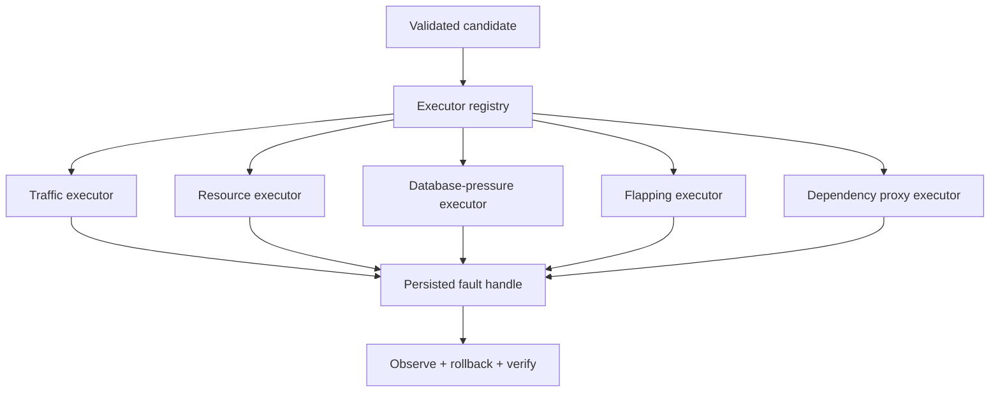

# Chaos Copilot Day 2 Fault Expansion Plan

**Audience:** Codex and the Chaos Copilot engineering team  
**Repository:** Standalone `chaos-copilot` repository  
**Target:** Separately running OpenTelemetry Astronomy Shop  
**Version:** 1.0  
**Date:** 10 October 2026  
**Status:** Ready for phased implementation

## 1. Purpose

This document defines the Day 2 implementation plan for expanding Chaos Copilot's fault catalogue.

The team has already implemented service/dependency mapping and baseline monitoring. Existing faults may include container crash/pause and network latency/loss. Codex must inspect the repository to confirm the exact current state before making changes.

The goal is to add distinct, reversible failures that test different resilience properties while preserving the existing policy, approval, execution, rollback, telemetry, scoring, and agentic-planning boundaries.

## 2. Day 2 target

Prioritize these faults:

1. `TRAFFIC_SPIKE`
2. `CPU_SATURATION`
3. `DATABASE_CONNECTION_PRESSURE`

Add only after the first three pass end-to-end tests:

4. `CONTAINER_FLAPPING`
5. `DEPENDENCY_TIMEOUT`
6. `CONNECTION_RESET`
7. `CONSUMER_PAUSE` / `QUEUE_BACKLOG`, if the full Kafka deployment is running

Optional only if time remains:

8. `BANDWIDTH_LIMIT`
9. `MEMORY_PRESSURE`
10. `DEPENDENCY_PARTITION`

Do not implement full-disk, host-level resource stress, data corruption, or observability-stack failure for the main Day 2 demo.

## 3. Success criteria

Day 2 fault expansion is successful when:

- at least three additional failure types work end to end;
- every enabled failure has deterministic parameter validation;
- every enabled failure has an idempotent rollback;
- every enabled failure has active-fault verification;
- every enabled failure has recovery verification;
- STOP invokes rollback for the active failure;
- unexpected exceptions invoke best-effort rollback;
- the observability and Chaos Copilot control planes remain protected;
- experiment reports identify the exact failure type and parameters;
- new faults are not exposed to the agent until their tests pass;
- the three-minute demo can show at least one new fault reliably.

## 4. Non-negotiable rules

1. Do not modify OpenTelemetry Astronomy Shop business-service source code.
2. Do not give the AI agent Docker, shell, Toxiproxy, Pumba, Locust, database, or fault-execution tools.
3. The agent may select only immutable candidate IDs generated by deterministic code.
4. Existing human approval remains mandatory.
5. Existing STOP and rollback paths remain authoritative.
6. Only one experiment and one target are active at a time.
7. Every fault must have a bounded duration.
8. Every fault must record original state before mutation.
9. Rollback must be idempotent.
10. A failed rollback is a critical operator-visible state.
11. No fault may target the host, Docker Desktop VM, Prometheus, Jaeger, Grafana, OpenTelemetry Collector, Chaos Copilot, or the active load-controller service.
12. Do not enable a failure enum merely because a schema exists. Enable it only after executor and rollback integration tests pass.

## 5. Recommended implementation stack

| Fault family | Recommended mechanism |
| --- | --- |
| Traffic | Existing Astronomy Shop Locust controller/API |
| Container lifecycle | Existing Docker SDK adapter |
| CPU/memory resource stress | Pumba stress through a fixed executor adapter |
| Dependency timeout/reset/bandwidth | Toxiproxy with preconfigured proxy edges |
| Database connection pressure | Dedicated ephemeral, bounded load container/process |
| Kafka backlog | Pause one allowlisted consumer service first |

Do not let the LLM construct commands. Every executor must construct operations from validated typed parameters.

## 6. Architecture changes

Extend the existing executor registry rather than creating a parallel runner.



Each fault uses the existing experiment state machine:

```text
VALIDATE
→ CAPTURE ORIGINAL STATE
→ INJECT
→ VERIFY ACTIVE
→ OBSERVE
→ ROLLBACK
→ VERIFY RECOVERED
→ ANALYZE
```

## 7. Executor contract

Reuse the repository's existing contract if equivalent. Otherwise converge on:

```python
from typing import Protocol


class FaultExecutor(Protocol):
    failure_type: "FailureType"

    async def validate(
        self,
        experiment: "ValidatedExperiment",
    ) -> "ExecutorValidation":
        ...

    async def inject(
        self,
        experiment: "ValidatedExperiment",
    ) -> "FaultHandle":
        ...

    async def verify_active(
        self,
        handle: "FaultHandle",
    ) -> "VerificationResult":
        ...

    async def rollback(
        self,
        handle: "FaultHandle",
    ) -> "RollbackResult":
        ...

    async def verify_recovered(
        self,
        handle: "FaultHandle",
    ) -> "VerificationResult":
        ...
```

Rollback must succeed when called more than once and when the fault is already absent.

## 8. Fault handle requirements

All executors must return and persist a fault handle before the runner marks injection successful.

```python
class FaultHandle(BaseModel):
    handle_id: str
    experiment_id: str
    failure_type: FailureType
    target_service: str
    target_identity: str
    injected_at: str
    expires_at: str
    original_state: dict
    applied_state: dict
    rollback_metadata: dict
    status: str
```

The handle must include enough information to reverse the fault without asking the AI or browser for parameters.

Never store secrets in `original_state` or `rollback_metadata`.

## 9. Failure type enum

Add only values approved by repository reconciliation:

```python
class FailureType(str, Enum):
    # Existing values
    CONTAINER_KILL = "CONTAINER_KILL"
    CONTAINER_PAUSE = "CONTAINER_PAUSE"
    NETWORK_DELAY = "NETWORK_DELAY"
    NETWORK_LOSS = "NETWORK_LOSS"

    # Day 2 core
    TRAFFIC_SPIKE = "TRAFFIC_SPIKE"
    CPU_SATURATION = "CPU_SATURATION"
    DATABASE_CONNECTION_PRESSURE = "DATABASE_CONNECTION_PRESSURE"

    # Day 2 follow-on
    CONTAINER_FLAPPING = "CONTAINER_FLAPPING"
    DEPENDENCY_TIMEOUT = "DEPENDENCY_TIMEOUT"
    CONNECTION_RESET = "CONNECTION_RESET"
    CONSUMER_PAUSE = "CONSUMER_PAUSE"
    QUEUE_BACKLOG = "QUEUE_BACKLOG"

    # Optional
    BANDWIDTH_LIMIT = "BANDWIDTH_LIMIT"
    MEMORY_PRESSURE = "MEMORY_PRESSURE"
    DEPENDENCY_PARTITION = "DEPENDENCY_PARTITION"
```

If the project dynamically registers supported types, prefer registry-derived API output over exposing every enum value.

## 10. Capability registry

The candidate generator and agent need a read-only capability view.

```python
class FaultCapability(BaseModel):
    failure_type: FailureType
    enabled: bool
    executor_ready: bool
    rollback_ready: bool
    supported_targets: list[str]
    parameter_schema_version: str
    safety_policy_version: str
    integration_tested: bool
    unavailable_reason: str | None = None
```

A capability may be returned as enabled only when:

- executor dependency is ready;
- rollback implementation exists;
- target matches allowlist and role rules;
- integration test evidence exists for the current implementation/version;
- required infrastructure such as Locust, Toxiproxy, PostgreSQL, or Kafka is reachable.

## 11. Fault 1: Traffic spike

### Goal

Test application capacity, saturation behavior, and graceful degradation under a bounded increase in user traffic.

### Target

The existing Astronomy Shop load generator and frontend journey set.

Do not target the load-generator container with a destructive fault. Control its configured traffic level through its supported interface.

### Parameters

```python
class TrafficSpikeParameters(BaseModel):
    baseline_users: int = Field(ge=1, le=20)
    peak_users: int = Field(ge=2, le=100)
    spawn_rate_per_second: int = Field(ge=1, le=20)
    duration_seconds: int = Field(ge=10, le=60)
    journey_profile: str
```

The policy must additionally require:

```text
peak_users > baseline_users
peak_users <= configured laptop ceiling
journey_profile belongs to configured profiles
```

Default starting profile for the 16 GB development laptop:

```yaml
baseline_users: 5
peak_users: 40
spawn_rate_per_second: 8
duration_seconds: 30
```

Codex must inspect the current workload and adjust defaults if this is too aggressive.

### Original state

Capture:

- current user count;
- current spawn rate;
- active journey profile;
- current run identifier;
- whether load generation was active before the experiment.

### Inject

- set peak user count;
- set bounded spawn rate;
- keep the configured journey profile;
- record actual activation time.

### Verify active

- load generator reports requested state;
- request rate rises above a configured factor of baseline;
- fault timer is active.

Do not require exact request-rate equality because workload behavior is variable.

### Observe

- frontend availability/error rate;
- frontend p95 latency;
- throughput;
- per-service CPU and memory;
- checkout and browse journey success;
- first service whose latency/error threshold changes materially.

### Rollback

- restore previous users, spawn rate, and profile;
- if load generation was originally inactive, stop it;
- verify traffic falls near baseline within recovery timeout.

### Hypothesis template

```text
Under a bounded traffic increase, latency may rise before errors, while core
journeys should remain available and return to baseline after load restoration.
```

### Tests

- parameter bounds;
- peak must exceed baseline;
- unsupported profile rejection;
- inject/restore against mocked adapter;
- STOP during spike;
- retry-safe rollback;
- load API unavailable;
- request rate fails to rise;
- integration test with small safe values.

## 12. Fault 2: CPU saturation

### Goal

Test latency propagation, timeout behavior, and service isolation under container-scoped CPU pressure.

### Preferred targets

Start with one stateless application service:

1. `recommendation` for lower blast radius; or
2. `product-catalog` for stronger critical-path impact.

Do not target PostgreSQL, Kafka, observability services, Docker, or the host in the first implementation.

### Mechanism

Use Pumba stress or the repository's existing bounded resource-stress adapter.

Do not run an arbitrary model-generated command. The executor maps validated parameters to a fixed invocation/API call.

### Parameters

```python
class CpuSaturationParameters(BaseModel):
    target_load_percent: int = Field(ge=25, le=85)
    workers: int = Field(ge=1, le=2)
    duration_seconds: int = Field(ge=10, le=45)
```

Default:

```yaml
target_load_percent: 75
workers: 1
duration_seconds: 30
```

The executor must verify the mechanism is container-scoped.

### Original state

Capture:

- target container ID and Compose labels;
- current CPU constraint/quota metadata;
- pre-fault CPU usage;
- health status;
- service start timestamp.

### Inject

- start one bounded stress process associated with the target;
- persist helper/process identity immediately;
- enforce duration independent of the model/client connection.

### Verify active

- stress helper/process is running;
- target CPU exceeds a minimum configured rise from baseline;
- target identity still belongs to expected Compose project.

### Observe

- target CPU;
- target and frontend p95 latency;
- error rate;
- request throughput;
- failed/downstream spans;
- journey success;
- queuing or timeout symptoms.

### Rollback

- stop/remove only the stress process identified by the handle;
- restore changed CPU constraints exactly, if any;
- verify CPU returns toward baseline;
- verify service health and sustained request recovery.

### Tests

- protected/stateful target rejection;
- load/worker/duration bounds;
- helper identity persisted;
- no host-level stress path;
- STOP during stress;
- helper already absent on rollback;
- CPU does not rise;
- integration test against a disposable container before live target.

## 13. Fault 3: Database connection pressure

### Goal

Test connection-pool limits, bounded queuing, database error propagation, and recovery without modifying application data.

### Target

`astronomy-db`, but pressure is created by a dedicated ephemeral load client. Do not execute arbitrary SQL from the AI or frontend.

### Safer mechanism

Use a fixed, repository-owned load script/container that:

- opens a bounded number of PostgreSQL connections;
- optionally executes a fixed read-only health query;
- holds connections for the configured duration;
- closes them on signal or timeout;
- makes no schema or data changes.

Do not use a benchmark initialization that creates tables.

### Parameters

```python
class DatabaseConnectionPressureParameters(BaseModel):
    additional_connections: int = Field(ge=1, le=15)
    hold_seconds: int = Field(ge=5, le=30)
    connection_ramp_per_second: int = Field(ge=1, le=5)
    query_profile: Literal["CONNECT_ONLY", "READ_ONLY_HEALTH"]
```

Policy also requires:

- requested connections do not exceed 30% of discovered/configured database capacity;
- credentials come from configured secret handling, never the model;
- write transactions are disabled;
- database reports healthy before injection.

### Original state

Capture:

- baseline active connections;
- configured maximum connections if available;
- baseline waiting connections;
- database health;
- existing pressure-client identities.

### Inject

- launch one uniquely labelled pressure client;
- ramp connections gradually;
- stop ramping if abort threshold or connection ceiling is reached;
- persist client identity and expected connections.

### Verify active

- pressure client is running;
- active connections rise by a minimum expected amount;
- no schema/data modification occurs;
- target database remains observable.

### Observe

- active and waiting connections;
- connection acquisition latency/errors;
- query latency;
- product-catalog and dependent service latency/errors;
- browse and checkout journey success;
- database CPU/memory as secondary evidence.

### Rollback

- stop/remove the exact pressure client;
- close client sessions;
- verify active connections return near baseline;
- verify dependent services and journeys recover.

### Automatic abort

Abort if:

- database health check fails twice;
- core availability falls below configured minimum;
- connection count exceeds planned bound;
- control-plane telemetry becomes unavailable;
- pressure-client heartbeat is lost.

### Tests

- connection-count bounds;
- percentage-of-capacity bound;
- missing database credentials;
- read-only query enforcement;
- gradual ramp;
- abort during ramp;
- client timeout cleanup;
- rollback with client already absent;
- verify sessions return to baseline;
- disposable PostgreSQL integration test before Astronomy Shop test.

## 14. Fault 4: Container flapping

### Goal

Test retry storms, circuit-breaker behavior, readiness handling, and stable recovery under repeated lifecycle interruption.

### Preferred target

`recommendation` or another allowlisted stateless, noncritical service.

### Parameters

```python
class ContainerFlappingParameters(BaseModel):
    cycles: int = Field(ge=2, le=4)
    down_seconds: int = Field(ge=2, le=5)
    healthy_seconds_between_cycles: int = Field(ge=3, le=10)
    max_total_duration_seconds: int = Field(ge=10, le=40)
```

### Safety requirements

- only one target;
- target must be stateless and unprotected;
- target must be running before the experiment;
- service identity must be re-resolved by Compose label after restart;
- total duration must be independently enforced;
- STOP terminates the cycle loop and leaves the service running.

### Fault handle

Record:

- original container ID;
- Compose service and project labels;
- original running/health status;
- current cycle;
- restarted container IDs;
- next scheduled action;
- cancellation state.

### Rollback

- cancel future cycles;
- ensure exactly the expected Compose service is running;
- do not start a service that was originally stopped;
- verify sustained health for a configured window.

### Tests

- protected/stateful target rejection;
- cycle/duration limits;
- container ID change after restart;
- STOP during down interval;
- STOP during healthy interval;
- runner process failure;
- idempotent final recovery.

## 15. Fault 5: Dependency timeout

### Goal

Test client deadlines, bounded failure, retry behavior, and dependency isolation when a connection is accepted but does not respond.

### Recommended edge

Start with one preconfigured edge such as:

```text
checkout → payment
```

Do not make arbitrary service-edge rewiring available through the API or agent.

### Mechanism

Use Toxiproxy only after the chosen dependency is deliberately routed through a preconfigured proxy. This may require deployment configuration outside the target's business-service source code.

### Parameters

```python
class DependencyTimeoutParameters(BaseModel):
    proxy_id: str
    direction: Literal["UPSTREAM", "DOWNSTREAM"]
    timeout_ms: int = Field(ge=100, le=5000)
    duration_seconds: int = Field(ge=5, le=30)
```

`proxy_id` must reference configured proxy metadata. Do not accept arbitrary host/port values.

### Rollback

- remove the exact toxic by unique toxic ID;
- verify proxy remains healthy;
- verify no experiment-owned toxics remain;
- verify the dependency journey succeeds.

### Tests

- unknown proxy rejection;
- target edge allowlist;
- parameter bounds;
- toxic creation/removal;
- rollback after toxic already removed;
- proxy unavailable;
- dependency route verification.

## 16. Fault 6: Connection reset

Use the same proxy registry and executor foundation as dependency timeout.

### Parameters

```python
class ConnectionResetParameters(BaseModel):
    proxy_id: str
    direction: Literal["UPSTREAM", "DOWNSTREAM"]
    reset_after_ms: int = Field(ge=0, le=5000)
    duration_seconds: int = Field(ge=5, le=30)
```

### Observe

- reset/transport errors;
- checkout success;
- retry behavior;
- duplicate-operation indicators;
- recovery after toxic removal.

### Rollback

Remove only the exact experiment-owned toxic and verify the clean dependency journey.

## 17. Fault 7: Kafka consumer pause and queue backlog

Implement only when the running target deployment includes Kafka and the selected consumer.

### Recommended first scenario

Pause `accounting` or `fraud-detection`, not Kafka itself.

### Goal

Verify that checkout remains decoupled from asynchronous consumers and that the backlog drains without message loss or duplicate processing.

### Parameters

```python
class ConsumerPauseParameters(BaseModel):
    consumer_service: str
    duration_seconds: int = Field(ge=10, le=45)
    require_broker_healthy: bool = True
```

### Observe

- checkout success;
- producer errors;
- consumer lag/backlog evidence;
- accounting/fraud processing rate;
- backlog drain time;
- duplicate or missing processing indicators.

### Rollback

- unpause the exact consumer;
- verify reconnection;
- wait for lag to approach baseline within recovery timeout;
- report partial recovery if backlog remains.

Do not implement broker outage until consumer-pause behavior is reliable.

## 18. Optional faults

### Bandwidth limit

Preferred target edge: product images or one preconfigured dependency proxy.

```python
class BandwidthLimitParameters(BaseModel):
    proxy_id: str
    rate_kilobytes_per_second: int = Field(ge=32, le=1024)
    duration_seconds: int = Field(ge=5, le=30)
```

### Memory pressure

Use only container-scoped stress with conservative limits suitable for the 16 GB laptop.

```python
class MemoryPressureParameters(BaseModel):
    allocation_mb: int = Field(ge=32, le=200)
    duration_seconds: int = Field(ge=5, le=20)
```

Do not intentionally trigger host swapping or Docker Desktop instability.

### Dependency partition

Allow only configured service edges. Record the exact rule identity and remove only that rule during rollback.

## 19. Faults explicitly deferred

Do not implement for the Day 2 main path:

- host CPU stress;
- host memory stress;
- Docker Desktop/WSL disk fill;
- root-filesystem fill;
- deleting or corrupting database data;
- flushing Valkey;
- deleting Kafka topics/messages;
- deleting Docker volumes;
- observability-stack shutdown;
- multi-target faults;
- combined faults;
- clock manipulation;
- certificate replacement;
- arbitrary DNS changes.

If a bounded disk experiment is later required, use only a dedicated disposable quota-limited volume and obtain explicit team approval before implementation.

## 20. Safety policy additions

Example configuration; reconcile with existing policy schema:

```yaml
faults:
  TRAFFIC_SPIKE:
    enabled: true
    max_peak_users: 50
    max_spawn_rate_per_second: 10
    max_duration_seconds: 45

  CPU_SATURATION:
    enabled: true
    max_load_percent: 85
    max_workers: 1
    max_duration_seconds: 30
    allow_stateful_targets: false

  DATABASE_CONNECTION_PRESSURE:
    enabled: true
    max_additional_connections: 15
    max_capacity_percent: 30
    max_duration_seconds: 30
    allow_write_queries: false

  CONTAINER_FLAPPING:
    enabled: false
    max_cycles: 3
    max_total_duration_seconds: 30
    allow_stateful_targets: false

  DEPENDENCY_TIMEOUT:
    enabled: false
    max_timeout_ms: 5000
    max_duration_seconds: 30

  CONNECTION_RESET:
    enabled: false
    max_duration_seconds: 30

  CONSUMER_PAUSE:
    enabled: false
    max_duration_seconds: 45

  MEMORY_PRESSURE:
    enabled: false
    max_allocation_mb: 200
    max_duration_seconds: 20

global:
  max_concurrent_experiments: 1
  max_targets_per_experiment: 1
  require_manual_approval: true
  require_rollback_action: true
  forbid_host_faults: true
  forbid_disk_fill: true
```

Defaults should remain disabled until the relevant integration tests pass.

## 21. Automatic abort conditions

Reuse existing abort logic and add fault-specific checks.

Global abort conditions:

- core journey availability below configured floor across two intervals;
- frontend error rate above configured ceiling across two intervals;
- observability/control plane unavailable;
- unexpected second target affected;
- executor/helper heartbeat lost;
- fault exceeds planned duration;
- target no longer belongs to configured Compose project;
- STOP requested.

Fault-specific aborts:

| Fault | Abort condition |
| --- | --- |
| Traffic spike | load exceeds planned users or control API becomes inconsistent |
| CPU saturation | target CPU/stress helper exceeds planned scope or host safety signal triggers |
| DB pressure | connections exceed plan/capacity bound or DB health fails twice |
| Flapping | target fails to return healthy within inter-cycle limit |
| Timeout/reset | proxy or unrelated routes become unavailable |
| Consumer pause | broker becomes unhealthy or lag exceeds configured safety ceiling |

Abort always attempts rollback before final analysis.

## 22. Telemetry and report additions

Add fault-specific evidence while preserving common baseline/fault/recovery windows.

### Common

- availability;
- error rate;
- p50/p95 latency;
- throughput;
- journey success;
- recovery time;
- service health;
- failed spans;
- target resource usage.

### Traffic spike

- active users;
- spawn rate;
- actual request rate;
- saturation point;
- first degraded service.

### CPU saturation

- target CPU baseline/fault/recovery;
- stress helper identity;
- latency/error propagation.

### Database pressure

- active/waiting connections;
- connection-acquisition latency/errors;
- query latency;
- actual additional connections;
- session cleanup.

### Flapping

- cycle timeline;
- container IDs;
- time to health per cycle;
- error spike per cycle;
- final sustained recovery.

### Proxy faults

- proxy ID;
- toxic ID/type;
- direction;
- transport/deadline error evidence;
- toxic removal verification.

### Queue faults

- consumer state;
- lag/backlog;
- drain duration;
- duplicate/loss indicators.

Reports must distinguish observed facts from AI interpretations.

## 23. Candidate generation and agent integration

A new failure becomes visible to the Planning Agent only after:

1. parameter schema exists;
2. executor is registered;
3. policy bounds exist;
4. target rules exist;
5. rollback exists and is idempotent;
6. active verification exists;
7. recovery verification exists;
8. integration test passes;
9. capability registry reports ready.

Candidate templates should include prerequisites:

```yaml
templates:
  - id: traffic-spike-core
    failure_type: TRAFFIC_SPIKE
    requires: [locust_ready, baseline_fresh]
    default_parameters:
      baseline_users: 5
      peak_users: 40
      spawn_rate_per_second: 8
      duration_seconds: 30

  - id: product-catalog-cpu
    failure_type: CPU_SATURATION
    target_services: [product-catalog]
    requires: [pumba_ready, target_healthy, baseline_fresh]
    default_parameters:
      target_load_percent: 75
      workers: 1
      duration_seconds: 30

  - id: bounded-db-connections
    failure_type: DATABASE_CONNECTION_PRESSURE
    target_services: [astronomy-db]
    requires: [database_ready, pressure_client_ready, baseline_fresh]
    default_parameters:
      additional_connections: 10
      hold_seconds: 20
      connection_ramp_per_second: 2
      query_profile: CONNECT_ONLY
```

Candidate generation must clamp or reject values rather than trusting template or model data.

## 24. API and UI impact

### API

Prefer existing generic experiment endpoints. Add only what is missing:

- fault capability/readiness endpoint;
- fault-specific parameter schema metadata;
- fault-handle status in experiment response;
- fault-specific evidence in report response.

Do not create separate start endpoints for each fault if the generic runner already supports typed experiments.

### UI

For every proposed fault display:

- failure type;
- target;
- exact bounded parameters;
- expected impact;
- policy checks;
- rollback action;
- automatic abort conditions;
- executor/tool readiness;
- Approve/Reject;
- persistent STOP during active phases.

During execution show fault-specific status, such as active users, CPU stress state, extra DB connections, flapping cycle, toxic ID, or consumer pause state.

## 25. Testing matrix

Every executor must pass:

| Test | Required |
| --- | --- |
| Valid parameters accepted | Yes |
| Below/above bounds rejected | Yes |
| Protected target rejected | Yes |
| Unknown target rejected | Yes |
| Stale target identity rejected | Yes |
| Inject success | Yes |
| Active verification | Yes |
| STOP during active fault | Yes |
| Duration timeout rollback | Yes |
| Exception after injection rollback | Yes |
| Rollback succeeds twice | Yes |
| Recovery verification | Yes |
| Helper already missing on rollback | Yes |
| Audit events | Yes |
| Report parameters/evidence | Yes |
| Candidate hidden until ready | Yes |

Use disposable targets for integration tests before using Astronomy Shop services.

## 26. Implementation phases

Codex must complete one phase, run tests, report the gate, and stop.

### Phase 0: Repository reconciliation

**Objective:** Determine what already exists and produce a minimal grounded change plan.

Tasks:

1. Read repository and nested `AGENTS.md` files.
2. Inspect git status and preserve unrelated changes.
3. Identify current failure enums, parameter schemas, policy rules, executor interface/registry, runner, fault handles, STOP/rollback, telemetry, reports, API, UI, candidate generator, and agent capability source.
4. List implemented and tested existing faults.
5. Identify Locust control interface actually available.
6. Determine whether Pumba or another resource-stress mechanism is already installed.
7. Identify PostgreSQL connectivity and a safe way to run a bounded read-only pressure client.
8. Determine whether the active deployment includes Kafka/accounting/fraud.
9. Identify actual service names and protected roles.
10. Propose exact files and tests for Phase 1.

Do not modify code.

**Gate:** Team approves the repository-grounded Phase 1 plan.

### Phase 1: Capability plumbing and Traffic Spike

**Objective:** Add the safest high-value failure using the existing load generator.

Tasks:

1. Add/reuse `TRAFFIC_SPIKE` parameter model.
2. Add policy limits.
3. Implement Locust/load-controller adapter.
4. Capture and persist original load state.
5. Implement inject, active verification, rollback, and recovery verification.
6. Integrate STOP and audit events.
7. Add fault-specific evidence/report fields.
8. Add capability readiness.
9. Add unit/integration tests.
10. Add candidate template only after tests pass.

**Gate:** A bounded spike raises traffic, restores original load, and produces a report without leaving the generator altered.

### Phase 2: CPU Saturation

**Objective:** Add container-scoped resource stress.

Tasks:

1. Confirm Pumba/resource tool availability and pin version/image where applicable.
2. Add CPU parameter model and policy.
3. Implement fixed executor adapter with no raw command input.
4. Persist helper/process and original constraint metadata.
5. Implement active verification and bounded timer.
6. Implement idempotent rollback and CPU recovery verification.
7. Test first on a disposable container.
8. Run low-load integration test on an allowlisted service.
9. Add evidence/report fields.
10. Enable candidate template after passing tests.

**Gate:** Stress remains container-scoped, raises target CPU, stops reliably, and target latency/health recover.

### Phase 3: Database Connection Pressure

**Objective:** Add a bounded stateful-system pressure experiment without writes.

Tasks:

1. Discover safe DB capacity and credentials handling.
2. Implement fixed read-only pressure client.
3. Add parameters and percentage/capacity policy.
4. Add gradual connection ramp and automatic abort.
5. Persist load-client identity.
6. Implement connection-count active verification.
7. Implement cleanup and session recovery verification.
8. Test against disposable PostgreSQL.
9. Test conservatively against Astronomy Shop.
10. Add evidence/report and candidate template.

**Gate:** Pressure is measurable and bounded; no data is changed; all pressure sessions close; dependent journeys recover.

### Phase 4: Container Flapping

**Objective:** Add repeated instability against a stateless service.

Tasks:

1. Add flapping schedule model/policy.
2. Implement cancellable cycle controller.
3. Re-resolve container identity by Compose labels after each restart.
4. Persist cycle progress.
5. Integrate STOP and application shutdown cleanup.
6. Ensure final desired state equals original state.
7. Add timeline evidence and tests.
8. Add candidate template only after tests.

**Gate:** All cycles are bounded and STOP always leaves the target in its original desired state.

### Phase 5: Dependency Proxy Foundation and Timeout

**Objective:** Add one precise dependency-level timeout.

Tasks:

1. Select one high-value dependency edge.
2. Add Toxiproxy deployment/configuration outside target business code.
3. Verify normal traffic through proxy.
4. Create static proxy registry and allowlist.
5. Implement timeout toxic executor.
6. Persist toxic ID and original proxy state.
7. Implement toxic removal and route recovery checks.
8. Add integration/adversarial tests.
9. Add candidate only for configured edge.

**Gate:** One dependency edge can time out and recover without affecting unrelated routes or leaving toxics behind.

### Phase 6: Connection Reset and Bandwidth Limit

**Objective:** Reuse verified proxy foundation for additional distinct network behaviors.

Tasks:

1. Implement reset and optional bandwidth parameter models.
2. Add policy bounds.
3. Reuse proxy/toxic lifecycle.
4. Add transport-error and bandwidth evidence.
5. Test toxic ownership and cleanup.
6. Enable one type at a time.

**Gate:** Every experiment removes only its own toxic and clean traffic resumes.

### Phase 7: Kafka Consumer Pause

**Objective:** Demonstrate asynchronous resilience if full deployment is available.

Tasks:

1. Confirm Kafka and selected consumer readiness.
2. Add consumer target allowlist.
3. Add pause parameters/policy.
4. Capture consumer/container original state.
5. Observe checkout and lag/backlog.
6. Unpause and measure drain.
7. Add partial-recovery state if lag remains.
8. Add tests and candidate only after verification.

**Gate:** Checkout behavior and backlog recovery are demonstrated without message/data deletion.

### Phase 8: Demo hardening

**Objective:** Ship a reliable Day 2 catalogue.

Tasks:

1. Run full fault test matrix.
2. Confirm capability endpoint exposes only ready faults.
3. Confirm Planning Agent receives only ready candidate types.
4. Rehearse STOP for each demo fault.
5. Verify no leftover stress processes, load settings, DB sessions, toxics, pauses, or cycles.
6. Select one primary and one backup new fault for presentation.
7. Update README, architecture, safety policy, findings report, and demo script.
8. Record backup demo.

**Gate:** Clean start to experiment to rollback to report works within the presentation time.

## 27. Recommended demo selection

Primary new Day 2 demonstration:

```text
AI investigates topology and baseline
→ chooses product-catalog CPU saturation
→ policy validates 75% / 30 seconds
→ human approves
→ CPU and p95 latency rise
→ automatic rollback
→ recovery measured
→ analyst explains propagation with evidence
```

Backup demonstration:

```text
Traffic spike from 5 to 40 users
→ observe first saturation signal
→ restore baseline users
→ generate findings report
```

Database connection pressure is a strong report/demo item but may be less visually predictable. Keep it as a third tested scenario.

## 28. Definition of done

The fault-expansion work is complete when:

- Traffic Spike, CPU Saturation, and Database Connection Pressure pass end-to-end tests;
- original state is captured before each mutation;
- fault handles are persisted;
- active state is verified;
- STOP works;
- rollback is idempotent;
- recovery is verified;
- telemetry/reporting includes fault-specific evidence;
- policy bounds reject excessive parameters;
- protected services cannot be targeted;
- no host-level fault path exists;
- capabilities expose only tested/ready faults;
- Planning Agent can select new faults only through immutable candidates;
- the demo has a primary and fallback scenario.

## 29. Codex operating rules

1. Read this document completely.
2. Read `CHAOS_COPILOT_PRD.md`, `AI_IMPLEMENTATION_PLAN.md`, `AGENTIC_AI_IMPLEMENTATION_PLAN.md`, and applicable `AGENTS.md` files.
3. Inspect the actual repository before assuming names or paths.
4. Preserve unrelated team changes.
5. Do not modify the OpenTelemetry Demo repository or business-service code.
6. Reuse the existing runner, policy, fault-handle, rollback, audit, telemetry, and agent boundaries.
7. Implement one phase at a time.
8. Do not expose incomplete faults to the API, UI, candidate generator, or agent.
9. Do not introduce raw shell/command fields.
10. Add tests with every executor.
11. Use conservative parameters during integration tests.
12. After each phase report:
    - files changed;
    - interfaces changed;
    - tests and results;
    - injection evidence;
    - rollback evidence;
    - recovery evidence;
    - deviations and risks;
    - proposed next phase.
13. Stop after the phase gate and wait for approval.

## 30. First Codex prompt

Run this from the standalone `chaos-copilot` repository root:

```text
Read DAY2_FAULT_EXPANSION_PLAN.md completely. Also read
CHAOS_COPILOT_PRD.md, AI_IMPLEMENTATION_PLAN.md,
AGENTIC_AI_IMPLEMENTATION_PLAN.md, and every applicable AGENTS.md file.

Perform Phase 0 only. Do not modify code.

Inspect the current repository and determine:

1. Which failure types, parameter schemas, policy rules, executors, fault
   handles, rollback paths, recovery checks, reports, UI elements, capability
   metadata, and candidate templates already exist.
2. Which existing faults have passing unit and integration tests.
3. How the current Locust/load generator can be controlled and restored.
4. Whether Pumba or another container-scoped resource-stress mechanism is
   already available.
5. How PostgreSQL credentials and connection counts can be accessed safely for
   a bounded read-only pressure client.
6. Whether the running deployment includes Kafka, accounting, and fraud
   services.
7. Exact target and protected service identifiers.
8. The smallest exact file change set for Phase 1: TRAFFIC_SPIKE.
9. Any discrepancy or missing prerequisite in the plan.

Preserve these invariants:

- one active experiment and one target;
- deterministic bounded parameter validation;
- explicit approval before injection;
- persisted fault handle;
- idempotent rollback;
- STOP and exception cleanup;
- no host-level fault;
- no raw command input;
- no direct AI execution tool;
- no candidate exposure before executor and rollback tests pass.

Return the repository-grounded Phase 0 findings and a Phase 1 implementation
proposal with file paths, model/interface changes, test cases, acceptance
checks, and any migrations. Wait for approval. Do not implement Phase 1 yet.
```

## 31. Phase 1 Codex prompt

Use only after approving Phase 0:

```text
Implement only the approved Phase 1 from DAY2_FAULT_EXPANSION_PLAN.md:
TRAFFIC_SPIKE.

Reuse the existing experiment runner, policy engine, rollback path, audit log,
telemetry/reporting, and candidate capability model. Add typed bounded
parameters, original-state capture, injection, active verification, idempotent
rollback, recovery verification, STOP/exception cleanup, fault-specific
evidence, and focused tests.

Do not implement CPU, database, proxy, flapping, Kafka, memory, bandwidth, disk,
or combined faults. Do not modify OpenTelemetry business-service code. Do not
expose TRAFFIC_SPIKE to the Planning Agent until the executor and rollback
integration tests pass and capability readiness reports true.

Run the approved test set, report Phase 1 gate evidence, and stop. Do not begin
Phase 2.
```

## 32. Reference links

- Pumba README: <https://github.com/alexei-led/pumba/blob/master/README.md>
- Pumba user guide: <https://github.com/alexei-led/pumba/blob/master/docs/guide.md>
- Toxiproxy README: <https://github.com/Shopify/toxiproxy/blob/main/README.md>
- Docker resource constraints: <https://docs.docker.com/engine/containers/resource_constraints/>
- Docker runtime metrics: <https://docs.docker.com/engine/containers/runmetrics/>
- OpenTelemetry Demo architecture: <https://opentelemetry.io/docs/demo/architecture/>

