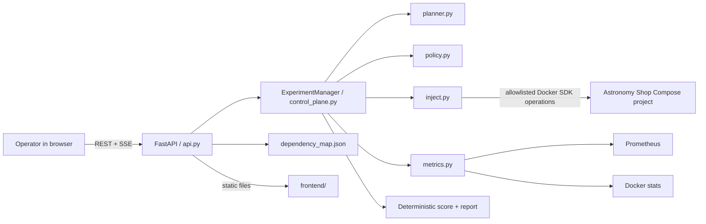

# Chaos Copilot frontend–backend integration report

**Date:** 10 October 2026  
**Scope:** Hackathon MVP integration for the OpenTelemetry Astronomy Shop  
**Safety note:** No real chaos fault was injected while verifying this work.

## 1. Executive summary

The pulled backend contained the important domain building blocks—topology
discovery, baseline metrics, AI/fallback planning, deterministic validation,
Docker fault injection, and rollback—but it did not expose an HTTP API or a
long-running experiment lifecycle. The existing command-line flow stopped
after saving an approval file.

The frontend already expected the REST and server-sent-event contract defined
in the PRD. The integration therefore adds a thin FastAPI control plane between
the browser and the existing Python modules. The browser never receives Docker
access and never sends commands. It sends a goal and, later, an explicit
approval; the server creates the fixed fault operation from validated data.

The integrated application now supports this loop:

```text
Discover -> Propose -> Validate -> Human approve -> Baseline -> Inject
         -> Observe -> Roll back -> Recover -> Score -> Report
```

The API and UI are served together at `http://127.0.0.1:8000`, avoiding CORS
and deployment complexity during the hackathon.

## 2. Architecture



The responsibilities are intentionally separated:

| Layer | Responsibility |
| --- | --- |
| Frontend | Show readiness, topology, proposal, policy, live state, STOP, and findings |
| FastAPI | Validate request shapes, expose REST/SSE, host static files, and enforce readiness before approval |
| Control plane | Own the state machine, one-active-run rule, abort signal, guaranteed rollback, scoring, and reports |
| Planner | Return one structured LLM plan or the deterministic fallback plan |
| Policy | Decide whether target, fault, magnitude, and duration are allowed |
| Injector | Resolve an exact Compose-labeled container, inject the fixed fault, and roll it back |
| Metrics | Read the saved baseline and collect live Prometheus/Docker snapshots |

## 3. What was changed

### New backend integration files

- `api.py`
  - Implements the PRD REST API.
  - Serves `frontend/` from `/`.
  - Streams state changes through server-sent events.
  - Checks Docker, target containers, Prometheus, Jaeger, the baseline, and
    unresolved fault state before approval.
  - Supports idempotency keys for mutating calls.
- `control_plane.py`
  - Adds the in-memory experiment state machine.
  - Runs experiments in a background thread so UI refreshes do not cancel the
    server-side rollback path.
  - Calls the existing planner, policy, injector, rollback, telemetry, and LLM
    judge functions.
  - Implements the PRD impact/resilience formula and separates evidence from
    AI interpretation.
- `tests/test_control_plane.py`
  - Tests completion, abort, rollback, missing telemetry, and score bounds with
    fake adapters. These tests cannot touch real containers.

### Existing backend fixes

- `discovery.py` now reads the target repository and Jaeger URLs from `.env`
  instead of another developer's absolute `C:\Users\rhea\...` path.
- `metrics.py` now reads the target repository and Prometheus URL from `.env`.
- `inject.py` now reads the exact Compose project name from `.env`.
- `requirements.txt` now declares FastAPI, Uvicorn, and `typing_extensions`.
- `.gitignore` now excludes `.venv/` and the recoverable active-fault state
  file.

### Frontend integration fixes

- The UI consumes real readiness, topology, baseline, proposal, policy,
  experiment, event, and report responses.
- The STOP flow waits for backend-confirmed rollback in live mode; it no longer
  simulates recovery after sending a real abort request.
- Terminal `completed`, `aborted`, and `failed` states close the live stream
  correctly.
- The readiness bar supports the backend's six checks.
- Frontend-only preview mode still falls back to visibly labelled demo data.

## 4. API contract

| Method | Endpoint | Connected implementation |
| --- | --- | --- |
| GET | `/api/health` | API status and current active experiment ID |
| GET | `/api/readiness` | Docker, target, Prometheus, Jaeger, safety, and baseline checks |
| GET | `/api/topology` | Converts the discovered graph into UI nodes/edges with protection and criticality |
| POST | `/api/baselines` | Captures a bounded baseline when no experiment is active |
| GET | `/api/baselines/latest` | Converts the stored frontend service baseline into headline metrics |
| POST | `/api/experiments/propose` | Calls the LLM planner or deterministic fallback catalogue |
| POST | `/api/experiments/{id}/validate` | Calls deterministic `policy.validate()` and returns seven readable checks |
| POST | `/api/experiments/{id}/approve` | Rechecks readiness, records the human, and starts the worker |
| POST | `/api/experiments/{id}/abort` | Sets the abort signal; the worker owns rollback and verification |
| GET | `/api/experiments/{id}` | Current state, live metrics, error, approval, and final report |
| GET | `/api/experiments/{id}/events` | Server-sent event stream for live phase updates |
| GET | `/api/reports/{id}` | Deterministic evidence, score, LLM verdict, and recommendation |
| GET | `/api/findings` | Reports ranked by measured impact |

## 5. How an experiment works

### Step 1: Readiness

The UI loads `/api/health`, `/api/readiness`, `/api/topology`, and the latest
baseline. Readiness is not cosmetic. The approval endpoint independently
rechecks Docker, the Compose project, Prometheus, Jaeger, the baseline file,
and unresolved active-fault state immediately before starting.

### Step 2: Proposal

The operator selects a learning goal. `planner.py` receives the dependency map,
baseline, protected services, and allowed faults. If Gemini is configured, it
returns structured JSON. If the key, network, or model output is unavailable,
the known-safe cart fallback is used and the UI labels its source.

The model never returns or executes a shell command.

### Step 3: Deterministic validation

`policy.py` is authoritative. It checks:

1. all required fields are present;
2. the fault is `container_stop` or `network_delay`;
3. the exact target exists in the discovered graph;
4. the target is not protected;
5. duration stays within the configured bound;
6. magnitude stays within the network-delay bound; and
7. an implemented rollback action exists.

The UI cannot enable approval until these checks pass and the operator checks
the human-review box.

### Step 4: Execution and STOP

The approval request records the operator name and starts a server-side worker.
The worker loads the baseline, records a live snapshot, and calls the existing
injector. The injector resolves exactly one container using both
`com.docker.compose.project` and `com.docker.compose.service` labels.

During observation, the UI receives phases and telemetry through SSE, with
polling as a fallback. Pressing STOP sets a thread-safe abort event. It does not
pretend that recovery happened: the UI waits for the backend to enter rollback,
remove the fault, collect a recovery snapshot, and emit the terminal state.

### Step 5: Guaranteed rollback

The worker calls rollback from its `finally` path whenever an injection began
or the recoverable `active_experiment.json` exists. Rollback is therefore
attempted after normal completion, STOP, telemetry errors, or executor errors.

For `container_stop`, rollback starts the exact saved container and verifies it
is running. For `network_delay`, it removes the `netem` queue discipline and
helper container. If rollback cannot be verified, the experiment becomes
`failed` and the UI shows a manual-action warning.

### Step 6: Evidence and scoring

Baseline and fault windows are compared using frontend availability, error
rate, p95 latency, and throughput. The score follows the PRD formula:

```text
impact = 100 × (
  0.35 × error impact +
  0.25 × latency impact +
  0.20 × availability loss +
  0.20 × recovery impact
)

resilience score = 100 - impact
```

Missing telemetry remains `No data`; it is not converted to a fake zero. The
report shows deterministic evidence separately from the LLM's hypothesis
verdict.

## 6. Running the application

From the Chaos Copilot repository:

```powershell
py -3.11 -m venv .venv
.\.venv\Scripts\Activate.ps1
python -m pip install -r requirements.txt
Copy-Item .env.example .env
python -m uvicorn api:app --host 127.0.0.1 --port 8000
```

Open <http://127.0.0.1:8000>.

Before approving a real experiment:

1. Start the Astronomy Shop Compose deployment.
2. Confirm `.env` points to that checkout and Compose project.
3. Confirm Prometheus and Jaeger are reachable.
4. Generate traffic and capture a representative baseline.
5. Refresh Chaos Copilot and require all readiness checks to be green.

## 7. Recommended three-minute judge demo

### 0:00–0:30 — Establish the problem

“Observability tells us what happened, but not which failure is safe and useful
to test. Chaos Copilot closes that loop while keeping the AI away from direct
execution.”

Show the readiness bar and topology. Point out protected orange/dashed nodes
and the criticality details when selecting a node.

### 0:30–1:00 — AI proposes, policy decides

Choose **Test graceful degradation** and generate a proposal. Explain:

“The model proposes one structured experiment. It cannot generate a command.
The deterministic policy independently verifies the exact target, blast
radius, duration, magnitude, protection status, and rollback.”

Run validation and show all policy checks.

### 1:00–1:20 — Human approval

Review the hypothesis and blast radius, select the human checkpoint, and click
**Approve & run**.

“Even a valid AI proposal cannot run without this explicit operator action.”

### 1:20–2:05 — Fault, observation, and rollback

Show the phase timeline and baseline-versus-live metrics. Point out that the
STOP control remains available while the fault is active.

“The browser does not control Docker. The backend executor touches one exact
Compose-labeled container and persists the rollback handle first.”

Let automatic rollback complete, or press STOP to demonstrate the emergency
path.

### 2:05–2:45 — Evidence, not theatre

Show the resilience score, metric comparisons, recovery time, and remediation.

“The score is deterministic for this scenario. The LLM interpretation is
visually separated, and missing telemetry is labelled instead of invented.”

### 2:45–3:00 — Close

“AI planned, policy constrained, a human approved, a fixed executor acted, and
OpenTelemetry proved the result.”

## 8. Likely judge questions

**Can the LLM run arbitrary commands?**  
No. The planner returns six JSON fields. Policy checks them, and the executor
selects one of two implemented Python code paths.

**How do you prevent attacking the wrong container?**  
The injector requires an exact Compose project label and exact Compose service
label, and refuses zero or multiple matches. Protected services are rejected
before approval.

**What happens if telemetry or analysis crashes?**  
Rollback is in the worker's `finally` path and does not depend on report
generation succeeding.

**What happens if the user closes the browser?**  
The experiment worker runs in the API process. Closing or refreshing the UI
does not cancel its timers or rollback path.

**Is the resilience score an overall reliability grade?**  
No. It describes behavior in one tested scenario and is labelled accordingly.

**What if the LLM is unavailable during the demo?**  
The planner uses a deterministic cart experiment and reports that it used the
fallback source.

## 9. Verification performed

- Four backend unit tests passed:
  - score boundaries and PRD formula;
  - missing telemetry remains missing;
  - normal run injects, rolls back, and reports;
  - manual abort still rolls back.
- Four frontend adapter tests passed.
- Python syntax compilation passed for all backend modules.
- JavaScript syntax checks passed.
- Live API smoke test passed for static UI hosting, health, readiness,
  topology, baseline, proposal, and validation.
- The smoke test returned 21 topology nodes and 32 edges.
- An approval attempt while Docker was unavailable returned HTTP 409 and left
  `active_experiment` empty.
- Connected-mode desktop rendering was visually checked.

## 10. Current MVP limitations

- Experiment state and historical findings are in memory and reset when the API
  restarts. The injector's active fault handle is persisted for rollback, but a
  future version should persist full experiment/audit state in SQLite.
- Recovery currently verifies container state through the injector and collects
  one recovery snapshot. A production version should require multiple healthy
  intervals and explicit business-journey checks.
- The current backend implements `container_stop` and `network_delay`; packet
  loss and a traffic-spike executor remain future work.
- The live score uses frontend headline metrics. Per-journey scoring and direct
  Jaeger trace links would make findings more precise.
- The baseline capture endpoint is synchronous and can take up to five minutes;
  it should become a background job for a polished product.
- The API process itself is the orchestration boundary. Process-restart
  reconciliation should be added before use beyond a disposable local demo.

These limitations are acceptable for a hackathon MVP as long as they are
presented honestly and the demo remains restricted to the local disposable
Compose environment.
