# Chaos Copilot

> AI proposes. Policy decides. A human approves. Telemetry proves what happened.

Chaos Copilot is an AI-assisted chaos-engineering platform for the
[OpenTelemetry Astronomy Shop](https://opentelemetry.io/docs/demo/). It is
designed to discover the application's service topology, propose a useful and
bounded resilience experiment, require explicit operator approval, inject the
fault inside a local Docker Compose sandbox, verify recovery, and turn the
resulting telemetry into an evidence-backed report.

The Astronomy Shop is the **system under test**. Chaos Copilot is the safety,
orchestration, observation, analysis, and reporting layer around it.

## Project status

This repository currently contains the **topology-discovery prototype**, the
first building block of the planned MVP. The prototype:

- reads service dependencies reported by Jaeger;
- supplements traces with dependencies found in the Astronomy Shop Compose
  configuration;
- classifies synchronous, asynchronous, database, and cache interactions;
- reconstructs sampled Locust user journeys;
- calculates fan-in, fan-out, and the checkout dependency path; and
- exports a machine-readable graph and a PNG visualization.

The experiment API, policy engine, human-approval flow, fault executors,
rollback controls, scoring, and UI described below are planned and are **not
yet implemented**. See [CHAOS_COPILOT_PRD.md](CHAOS_COPILOT_PRD.md) for the
complete requirements and delivery plan.

## Why Chaos Copilot?

Observable microservices provide a great deal of data, but they do not answer
the operational questions that matter during a failure:

- Which dependency is the most useful one to test?
- Which failure is safe and informative?
- Does the application degrade gracefully?
- How quickly does it recover?
- Which resilience weakness should be fixed first?

Chaos Copilot closes that loop while keeping authority outside the model. The
LLM may propose a structured experiment, but deterministic policy validates
it, a human must approve it, and a fixed executor performs only allowlisted
actions with an idempotent rollback path.

## Architecture

```mermaid
flowchart LR
    Operator[Operator UI] --> API[Chaos Copilot API]
    API --> Planner[AI planner]
    Planner --> Policy[Safety policy]
    Policy --> Runner[Experiment runner]
    Runner --> Faults[Bounded fault executors]
    Faults --> Shop[OpenTelemetry Astronomy Shop]
    Shop --> OTel[OpenTelemetry Collector]
    OTel --> Observability[Prometheus and Jaeger]
    Observability --> Analyzer[Analyzer and scorer]
    Analyzer --> Reports[Findings and reports]
    Reports --> Operator
```



The intended experiment lifecycle is:

```text
Draft -> Validated -> Approved -> Baseline -> Injecting -> Observing
      -> Rolling Back -> Recovering -> Analyzing -> Completed
```

At most one experiment may be active in the MVP. Every active path, including
abort and error paths, must pass through rollback.

## Safety model

Chaos Copilot is intended only for a local, disposable Docker Compose
environment. Its core guardrails are:

- no raw commands from a user or an LLM;
- exact target allowlists and a protected-service denylist;
- one target and one active experiment at a time;
- explicit human approval before injection;
- bounded duration and fault severity;
- a known rollback action before an experiment may start;
- automatic abort thresholds and a persistent emergency stop;
- Compose project-label verification immediately before mutation; and
- best-effort, idempotent rollback on abort, error, or shutdown.

The control plane, load generator, and observability services are protected by
default, including `chaos-copilot`, `otel-collector`, `prometheus`, `jaeger`,
`grafana`, `opensearch`, and `load-generator`.

> [!WARNING]
> Do not point this project at production, a shared environment, or containers
> outside the configured Astronomy Shop Compose project. Docker socket access
> grants powerful control over the local machine and must be limited to the
> disposable hackathon sandbox.

## Planned MVP capabilities

| Area | MVP outcome |
| --- | --- |
| Discovery | Compose inventory enriched with Jaeger trace relationships |
| Baseline | Repeatable load with availability, errors, throughput, and p50/p95 latency |
| Planning | Provider-neutral LLM returns a schema-validated JSON proposal |
| Policy | Deterministic validation of target, severity, duration, approval, and rollback |
| Faults | Container kill, container pause, and bounded network delay/loss |
| Observation | Explicit baseline, fault, and recovery windows from Prometheus and Jaeger |
| Recovery | Automatic rollback, health verification, and a global emergency stop |
| Reporting | Markdown and JSON reports with evidence, severity, and resilience score |
| UI | A single-screen operator workflow, initially implemented with Streamlit |

The initial experiment catalogue targets:

1. `recommendation` — container crash while catalog browsing remains usable;
2. `product-catalog` — bounded network degradation to reveal timeout and retry
   behavior; and
3. `valkey-cart` — container pause to isolate cart failure from browse-only
   journeys.

## Current topology prototype

The generated map combines Jaeger's dependency endpoint with sampled OTLP JSON
traces and the Compose configuration. Solid edges were observed in traces;
dashed edges were inferred from configuration for otherwise hidden data
dependencies.


Generated artifacts:

| File | Description |
| --- | --- |
| [`dependency_map.json`](dependency_map.json) | Nodes, annotated edges, graph statistics, and reconstructed user journeys |
| [`dependency_map.png`](dependency_map.png) | Visual dependency graph |

The checked-in sample contains 21 services and journeys such as product
browsing, recommendations, cart operations, and checkout. Generated files are
point-in-time evidence and should be refreshed against the running target
before making experiment decisions.

## Run the discovery prototype

### Prerequisites

- Python 3.10 or newer;
- a local clone of the OpenTelemetry Astronomy Shop;
- Docker with the Astronomy Shop and its observability stack running; and
- recent traffic in Jaeger, normally produced by the demo's load generator.

The PRD targets Python 3.12 for the eventual application.

### 1. Start Astronomy Shop

From the OpenTelemetry Demo repository, start the deployment mode supported by
your machine. Follow the upstream
[Docker deployment documentation](https://opentelemetry.io/docs/demo/docker-deployment/)
and confirm the storefront and Jaeger UI are reachable before continuing.

### 2. Create a Python environment

PowerShell:

```powershell
py -3.12 -m venv .venv
.\.venv\Scripts\Activate.ps1
python -m pip install -r requirements.txt
```

macOS or Linux:

```bash
python3 -m venv .venv
source .venv/bin/activate
python -m pip install -r requirements.txt
```

### 3. Point the prototype at your demo

The current script predates the planned settings layer. Before running it,
update these constants near the top of [`discovery.py`](discovery.py):

- `DEMO_DIR` — absolute path to the OpenTelemetry Demo checkout;
- `JAEGER_URL` — Jaeger dependency endpoint; and
- `TRACES_URL` — Jaeger v2 OTLP-JSON trace endpoint.

An [`.env.example`](.env.example) is included for the future application
configuration, but `discovery.py` does not consume it yet.

### 4. Generate the topology

```powershell
python discovery.py
```

On success, the command prints graph statistics and journey data, then rewrites
`dependency_map.json` and `dependency_map.png` in the current directory. If no
dependencies are returned, leave the Astronomy Shop load generator running and
try again after it has produced recent traces.

## Repository contents

```text
.
├── CHAOS_COPILOT_PRD.md   # Product requirements and implementation phases
├── README.md              # Project overview and prototype instructions
├── discovery.py           # Trace- and Compose-based topology discovery
├── dependency_map.json    # Sample generated graph and journey data
├── dependency_map.png     # Sample generated graph visualization
├── requirements.txt       # Prototype Python dependencies
└── .env.example           # Planned runtime settings and safety limits
```

## Roadmap

Development follows the PRD's safety-first phases:

1. **Safe control plane** — typed models, Docker discovery, deterministic
   policy, manual approval, `CONTAINER_PAUSE`, emergency abort, and tested
   idempotent rollback.
2. **Observability and baseline** — Prometheus/Jaeger adapters, Locust control,
   explicit measurement windows, scoring, and reports.
3. **Additional executors** — container kill plus bounded network delay/loss,
   with cleanup verification.
4. **AI planner** — schema-constrained proposals with deterministic catalogue
   fallback; never executable commands.
5. **Operator experience** — Streamlit UI, live experiment events, findings,
   architecture documentation, and a rehearsed three-minute demo.

Stretch work such as traffic spikes, combined failures, and Kubernetes support
must not displace incomplete safety or rollback requirements.

## Contributing

Keep changes scoped to Chaos Copilot and preserve the upstream Astronomy Shop's
business behavior. New instrumentation must follow the OpenTelemetry Demo's
telemetry-schema conventions. Before proposing a change:

1. read the [PRD](CHAOS_COPILOT_PRD.md) and the applicable `AGENTS.md` files;
2. implement one approved phase or milestone at a time;
3. add tests for policy, state transitions, executors, rollback, and reporting;
4. manually verify changes against the local Compose sandbox; and
5. document changed files, tests run, limitations, and the next safe step.

Never run a destructive experiment without explicit operator confirmation. Do
not add host-level or full-disk faults.

## License

No project-specific license file is currently included. Add or confirm the
license before distributing Chaos Copilot independently.
