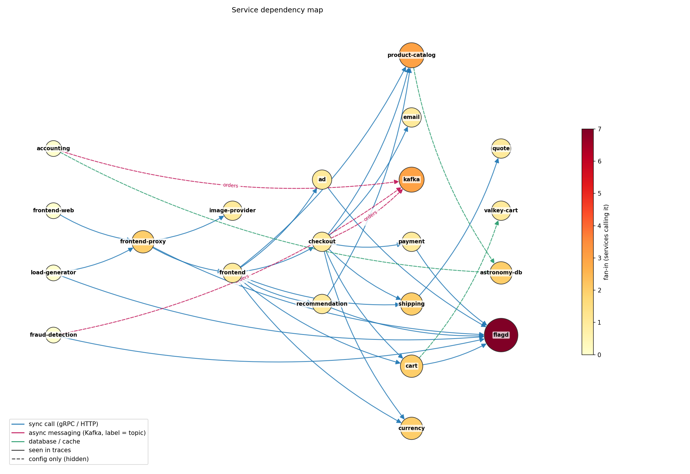

# Chaos Copilot

> AI proposes. Policy decides. A human approves. Telemetry proves what happened.

Chaos Copilot is an AI-assisted chaos-engineering platform for the
[OpenTelemetry Astronomy Shop](https://opentelemetry.io/docs/demo/). It is
designed to discover the application's service topology, propose a useful and
bounded resilience experiment, require explicit operator approval, inject the
fault inside a local Docker Compose sandbox, verify recovery, and turn the
resulting telemetry into an evidence-backed report.

The Astronomy Shop is the **system under test**. Chaos Copilot is the safety,
orchestration, observation, analysis, and reporting layer around it.

## Project status

This repository now contains an integrated **hackathon MVP control plane and
operator UI**. It:

- reads service dependencies reported by Jaeger;
- supplements traces with dependencies found in the Astronomy Shop Compose
  configuration;
- classifies synchronous, asynchronous, database, and cache interactions;
- reconstructs sampled Locust user journeys;
- calculates fan-in, fan-out, and the checkout dependency path; and
- exports a machine-readable graph and a PNG visualization;
- proposes one LLM or deterministic fallback experiment;
- validates it through deterministic policy before approval;
- executes bounded container-stop or network-delay faults;
- guarantees rollback on completion, abort, or execution error;
- streams experiment state and telemetry to a single-screen web UI;
- plots live request-rate, error-rate, and latency timelines with Grafana panel links; and
- generates deterministic impact and resilience scores.

See [INTEGRATION_REPORT.md](INTEGRATION_REPORT.md) for the component map,
endpoint contract, safety flow, and judge-facing demo explanation.

## Run the integrated application

Create the local environment once:

```powershell
py -3.11 -m venv .venv
.\.venv\Scripts\Activate.ps1
python -m pip install -r requirements.txt
Copy-Item .env.example .env
```

Update `.env` if the Astronomy Shop checkout or local ports differ, then start
the API and UI together:

```powershell
python -m uvicorn api:app --host 127.0.0.1 --port 8000
```

Open <http://127.0.0.1:8000>. FastAPI serves the frontend and all `/api/*`
routes from the same localhost origin. Do not approve an experiment unless the
target is the disposable local Compose project and the readiness bar is green.

## Why Chaos Copilot?

Observable microservices provide a great deal of data, but they do not answer
the operational questions that matter during a failure:

- Which dependency is the most useful one to test?
- Which failure is safe and informative?
- Does the application degrade gracefully?
- How quickly does it recover?
- Which resilience weakness should be fixed first?

Chaos Copilot closes that loop while keeping authority outside the model. The
LLM may propose a structured experiment, but deterministic policy validates
it, a human must approve it, and a fixed executor performs only allowlisted
actions with an idempotent rollback path.

## Architecture

```mermaid
flowchart LR
    Operator[Operator UI] --> API[Chaos Copilot API]
    API --> Planner[AI planner]
    Planner --> Policy[Safety policy]
    Policy --> Runner[Experiment runner]
    Runner --> Faults[Bounded fault executors]
    Faults --> Shop[OpenTelemetry Astronomy Shop]
    Shop --> OTel[OpenTelemetry Collector]
    OTel --> Observability[Prometheus and Jaeger]
    Observability --> Analyzer[Analyzer and scorer]
    Analyzer --> Reports[Findings and reports]
    Reports --> Operator
```



The intended experiment lifecycle is:

```text
Draft -> Validated -> Approved -> Baseline -> Injecting -> Observing
      -> Rolling Back -> Recovering -> Analyzing -> Completed
```

At most one experiment may be active in the MVP. Every active path, including
abort and error paths, must pass through rollback.

## Safety model

Chaos Copilot is intended only for a local, disposable Docker Compose
environment. Its core guardrails are:

- no raw commands from a user or an LLM;
- exact target allowlists and a protected-service denylist;
- one target and one active experiment at a time;
- explicit human approval before injection;
- bounded duration and fault severity;
- a known rollback action before an experiment may start;
- automatic abort thresholds and a persistent emergency stop;
- Compose project-label verification immediately before mutation; and
- best-effort, idempotent rollback on abort, error, or shutdown.

The control plane, load generator, and observability services are protected by
default, including `chaos-copilot`, `otel-collector`, `prometheus`, `jaeger`,
`grafana`, `opensearch`, and `load-generator`.

> [!WARNING]
> Do not point this project at production, a shared environment, or containers
> outside the configured Astronomy Shop Compose project. Docker socket access
> grants powerful control over the local machine and must be limited to the
> disposable hackathon sandbox.

## Planned MVP capabilities

| Area | MVP outcome |
| --- | --- |
| Discovery | Compose inventory enriched with Jaeger trace relationships |
| Baseline | Repeatable load with availability, errors, throughput, and p50/p95 latency |
| Planning | Provider-neutral LLM returns a schema-validated JSON proposal |
| Policy | Deterministic validation of target, severity, duration, approval, and rollback |
| Faults | Container kill, container pause, and bounded network delay/loss |
| Observation | Explicit baseline, fault, and recovery windows from Prometheus and Jaeger |
| Recovery | Automatic rollback, health verification, and a global emergency stop |
| Reporting | Markdown and JSON reports with evidence, severity, and resilience score |
| UI | A single-screen operator workflow, initially implemented with Streamlit |

The initial experiment catalogue targets:

1. `recommendation` — container crash while catalog browsing remains usable;
2. `product-catalog` — bounded network degradation to reveal timeout and retry
   behavior; and
3. `valkey-cart` — container pause to isolate cart failure from browse-only
   journeys.

## Current topology prototype

The generated map combines Jaeger's dependency endpoint with sampled OTLP JSON
traces and the Compose configuration. Solid edges were observed in traces;
dashed edges were inferred from configuration for otherwise hidden data
dependencies.



Generated artifacts:

| File | Description |
| --- | --- |
| [`dependency_map.json`](dependency_map.json) | Nodes, annotated edges, graph statistics, and reconstructed user journeys |
| [`dependency_map.png`](dependency_map.png) | Visual dependency graph |

The checked-in sample contains 21 services and journeys such as product
browsing, recommendations, cart operations, and checkout. Generated files are
point-in-time evidence and should be refreshed against the running target
before making experiment decisions.

## Run the discovery prototype

### Prerequisites

- Python 3.10 or newer;
- a local clone of the OpenTelemetry Astronomy Shop;
- Docker with the Astronomy Shop and its observability stack running; and
- recent traffic in Jaeger, normally produced by the demo's load generator.

The PRD targets Python 3.12 for the eventual application.

### 1. Start Astronomy Shop

From the OpenTelemetry Demo repository, start the deployment mode supported by
your machine. Follow the upstream
[Docker deployment documentation](https://opentelemetry.io/docs/demo/docker-deployment/)
and confirm the storefront and Jaeger UI are reachable before continuing.

To use the Grafana panels in the experiment UI, also pass this repository's
[`grafana-embed.yaml`](grafana-embed.yaml) override. It only lets Grafana be embedded in an
iframe (`GF_SECURITY_ALLOW_EMBEDDING=true`), so the demo repository is never modified. For
the default deployment (full demo plus observability):

```powershell
# run from the opentelemetry-demo checkout; adjust the path to this repository
docker compose -f compose.yaml -f compose.full.yaml -f compose.observability.yaml `
  -f C:\path\to\Team-9---Bosch-Hackathon\grafana-embed.yaml up -d
```

If the demo is already running, recreate only Grafana with the same `-f` files (add any others
you started with, e.g. `compose.extras.yaml`) plus the override:

```powershell
docker compose -f compose.yaml -f compose.full.yaml -f compose.observability.yaml `
  -f C:\path\to\Team-9---Bosch-Hackathon\grafana-embed.yaml up -d --no-deps grafana
```

Recreating the container resets Grafana's own database (provisioned dashboards reload from
files). Without the override the experiment UI still works; the Grafana panels stay blank and
the readiness panel says so.

If `product-catalog` turns unhealthy and pins its 20 MiB limit (product pages time out), add a `compose.chaos-override.yaml` in the demo checkout that raises its memory to 64M (`GOMEMLIMIT=52MiB`), and pass it with `-f` like the override above.

### 2. Create a Python environment

PowerShell:

```powershell
py -3.12 -m venv .venv
.\.venv\Scripts\Activate.ps1
python -m pip install -r requirements.txt
```

macOS or Linux:

```bash
python3 -m venv .venv
source .venv/bin/activate
python -m pip install -r requirements.txt
```

### 3. Point the prototype at your demo

Copy [`.env.example`](.env.example) to `.env` and configure
`TARGET_REPOSITORY_PATH`, `TARGET_COMPOSE_PROJECT`, `PROMETHEUS_URL`, and
`JAEGER_URL`. Discovery and telemetry use these values directly; no source-code
path edits are required.

### 4. Generate the topology

```powershell
python discovery.py
```

On success, the command prints graph statistics and journey data, then rewrites
`dependency_map.json` and `dependency_map.png` in the current directory. If no
dependencies are returned, leave the Astronomy Shop load generator running and
try again after it has produced recent traces.

## Run the experiment UI

Beyond topology discovery the repo now contains the experiment loop: plan
(`planner.py`), validate (`policy.py`), inject and roll back (`inject.py`),
guard (`guard.py`), and report (`run_experiment.py`), with a web UI on top.

**Prerequisites**

1. Astronomy Shop running via Docker Compose, with every feature flag off.
2. `pip install -r requirements.txt`
3. `.env` containing `LLM_API_KEY` (a Gemini key; see `.env.example`). Without it the planner uses a built-in
   fallback plan (stop `cart` for 60 s) and says so.
4. `python discovery.py` (writes `dependency_map.json`) and `python metrics.py` (writes `baseline.json`, about
   5 minutes). Re-capture the baseline whenever traffic or flags change.

**Start the UI**

```bash
python app.py
# open http://127.0.0.1:8000
```

The server binds to `127.0.0.1` only. Flow: check the readiness panel, **Propose experiment**, read the plan and
blast radius, **Approve**, watch the live charts, press **STOP** at any time, read the result. Past results are
under `results/` and listed in the History panel.

**Terminal mode** still works: `python run_experiment.py` proposes, prints, and asks `y/n`.

**What the UI shows**

- **Keyboard and screen readers:** a skip link, a real button for every action, and an *Inspect service* menu plus zoom
  buttons as the keyboard route into the dependency graph. Phase changes (plan proposed, fault active, rolling back,
  result ready) are announced, errors appear in a dismissible banner under the top bar, and focus follows the layout when
  the live view or the result moves to the top.

- **Layout:** a top bar with a step navigation (it highlights where you are). The page re-composes around what matters
  now: the live view comes first while a fault runs, the result comes first once it is over, and readiness folds into
  one line when everything is green. It works down to phone width; the red STOP becomes a full-width bar at the bottom.

- **Dependency graph:** services laid out left to right by call depth (callers on the left, data stores and the
  flag service on the right), with edge width for call volume and node height for fan-in. Click a service to see
  its role, live container health, criticality, baseline numbers, and what it calls and is called by; hover an
  edge for its protocol, operations and latency. Pick a user journey (or the checkout path) to light up its route
  with numbered steps. Protected services are marked and can never be targeted.
- **Optional learning goal** next to *Propose experiment* (graceful degradation, critical dependency, recovery time,
  timeout behaviour). It steers the AI; the safety policy still decides.
- **Safety gate:** every policy check is listed as passed or failed, and *Approve* needs the "I reviewed the
  hypothesis and blast radius" box ticked.
- **Result:** a resilience score out of 100 (deterministic: error rise, latency rise, shop-probe availability,
  recovery time), a claim-by-claim verdict, amplification ratios, and a recommended next move.

**Workflow panel and design system.** Both UIs (this one, `python app.py`, and the PRD UI in `frontend/`, `uvicorn api:app`)
share `chaos-ui.css`, `chaos-ui.js` and `component-meta.json`. The **Agent & Workflow Activity** card shows the lifecycle
stepper and six components; each component has an *implementation status* (from `component-meta.json`, edit it when a
component's maturity changes) and a separate *runtime status* (from the live state and events only, never invented).
Keep the two copies of the shared files identical: `tests/test_design_system.py` fails when they drift.

**Tests:** `python -m unittest discover -s tests -t .` (no containers are touched; the LLM and Docker are stubbed). It also
runs the node tests for both UIs when node is installed (`cd frontend && npm test` runs the api-UI ones alone).

**Safety.** STOP, a threshold breach and Ctrl+C all take the same rollback path. On startup `app.py` (and
`run_experiment.py`) first rolls back any fault left in `active_experiment.json` by a crashed run. Stopping the
server while an experiment runs aborts it and waits for the rollback. The guard reads recent spans from Jaeger
rather than Prometheus, because span metrics reach Prometheus only once a minute.

## Repository contents

```text
.
├── CHAOS_COPILOT_PRD.md   # Product requirements and implementation phases
├── INTEGRATION_REPORT.md   # Architecture, demo flow, and judge explanation
├── README.md              # Project setup and overview
├── api.py                 # REST/SSE API and static frontend hosting
├── control_plane.py       # State machine, rollback, scoring, and reports
├── discovery.py           # Trace- and Compose-based topology discovery
├── dependency_map.json    # Sample generated graph and journey data
├── dependency_map.png     # Sample generated graph visualization
├── frontend/              # Single-screen operator console (api.py UI)
├── static/                # The app.py UI (index.html) plus the shared chaos-ui.* design system
├── tests/                 # Safe tests with fake fault/telemetry adapters
├── requirements.txt       # Python dependencies
└── .env.example           # Runtime endpoints and safety configuration
```

## Roadmap

Development follows the PRD's safety-first phases:

1. **Safe control plane** — typed models, Docker discovery, deterministic
   policy, manual approval, `CONTAINER_PAUSE`, emergency abort, and tested
   idempotent rollback.
2. **Observability and baseline** — Prometheus/Jaeger adapters, Locust control,
   explicit measurement windows, scoring, and reports.
3. **Additional executors** — container kill plus bounded network delay/loss,
   with cleanup verification.
4. **AI planner** — schema-constrained proposals with deterministic catalogue
   fallback; never executable commands.
5. **Operator experience** — Streamlit UI, live experiment events, findings,
   architecture documentation, and a rehearsed three-minute demo.

Stretch work such as traffic spikes, combined failures, and Kubernetes support
must not displace incomplete safety or rollback requirements.

## Contributing

Keep changes scoped to Chaos Copilot and preserve the upstream Astronomy Shop's
business behavior. New instrumentation must follow the OpenTelemetry Demo's
telemetry-schema conventions. Before proposing a change:

1. read the [PRD](CHAOS_COPILOT_PRD.md) and the applicable `AGENTS.md` files;
2. implement one approved phase or milestone at a time;
3. add tests for policy, state transitions, executors, rollback, and reporting;
4. manually verify changes against the local Compose sandbox; and
5. document changed files, tests run, limitations, and the next safe step.

Never run a destructive experiment without explicit operator confirmation. Do
not add host-level or full-disk faults.

## License

No project-specific license file is currently included. Add or confirm the
license before distributing Chaos Copilot independently.
