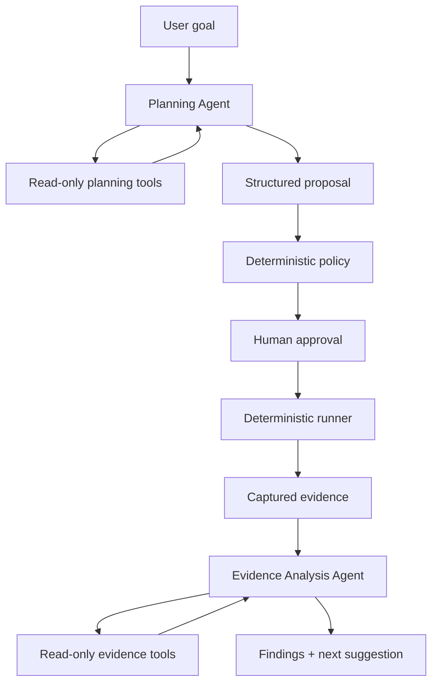

# Chaos Copilot Agentic AI Implementation Plan

**Audience:** Codex and the Chaos Copilot engineering team  
**Repository:** Standalone `chaos-copilot` repository  
**Target:** Separately running OpenTelemetry Astronomy Shop  
**Version:** 1.0  
**Date:** 10 October 2026  
**Status:** Ready for phased implementation

## 1. Purpose

This document defines how to implement the agentic portion of Chaos Copilot.

The implementation must create agents that autonomously investigate topology, baseline telemetry, experiment history, and experiment evidence. The agents may choose which read-only tools to call and in which order. They may submit structured proposals and findings, but they may never operate Docker or execute a fault.

This document supersedes the one-shot planner design in `AI_IMPLEMENTATION_PLAN.md` where the two documents conflict. The broader product requirements and deterministic safety requirements remain unchanged.

## 2. Existing prerequisites

The following are assumed to exist before implementing the agent layer:

- target service discovery;
- service/dependency graph;
- service roles and protected-service classification;
- monitoring baseline capture;
- Prometheus and/or Jaeger adapters;
- deterministic safety policy;
- experiment runner;
- rollback and emergency stop;
- experiment persistence and audit events, or an agreed interface for them.

If any prerequisite is absent, Codex must report it during Phase 0. It must not hide the missing capability inside an agent tool.

## 3. Definition of agentic behavior

The system is agentic when the model can:

1. receive a high-level testing goal;
2. decide what information is missing;
3. select an allowed read-only tool;
4. inspect the tool result;
5. revise its investigation;
6. repeat within strict budgets;
7. submit a structured proposal or analysis;
8. use previous experiment memory to adapt the next investigation.

The system is not considered agentic merely because it makes a single structured-output call.

## 4. Architectural decision

Implement two specialized agents with disjoint read-only toolsets:

1. **Planning Agent** — investigates the current system and selects one immutable safe candidate.
2. **Evidence Analysis Agent** — investigates completed experiment evidence and produces evidence-linked findings.

Do not implement an AI Safety Agent, Execution Agent, or Rollback Agent. Those responsibilities remain deterministic code.



## 5. Trust boundary

### 5.1 Agent plane

Agents may:

- inspect topology summaries;
- inspect known services;
- inspect baseline summaries;
- inspect business journeys;
- inspect experiment history;
- request deterministic safe candidates;
- compare candidate metadata;
- inspect bounded metric comparisons;
- inspect bounded trace summaries;
- inspect container event summaries;
- retrieve curated resilience patterns;
- submit a proposal;
- submit evidence-linked findings;
- suggest a next experiment goal.

Agents may not:

- call Docker;
- run shell commands;
- write PromQL or arbitrary queries;
- kill, pause, restart, or inspect raw containers;
- add or remove network rules;
- change load directly;
- start, approve, abort, or roll back an experiment;
- change safety-policy configuration;
- modify source code;
- access secrets;
- use web search or arbitrary network access;
- invent an executable experiment.

### 5.2 Control plane

Deterministic code owns:

- candidate generation;
- parameter bounds;
- protected-service rules;
- policy decisions;
- validated-plan creation;
- approval verification;
- execution;
- abort thresholds;
- rollback;
- recovery verification;
- metric calculations;
- impact/resilience scoring.

### 5.3 Required invariant

```text
No path exists from an agent tool call to a mutating infrastructure operation.
```

Enforce this structurally with separate tool registries and service interfaces, not only with prompt text.

## 6. Recommended implementation approach

Use a custom bounded function-calling loop built with:

- Python 3.12;
- existing FastAPI backend;
- official OpenAI Python SDK;
- Responses API function calling;
- Pydantic v2 for tool arguments, tool results, and terminal outputs;
- existing persistence and audit layers;
- existing OpenTelemetry instrumentation where practical.

Use LangGraph only for the read-only planning and evidence-analysis workflows. The deterministic experiment state machine, approval, execution, guard, and rollback remain outside the graph.

The provider and agent runner must remain separated so a deterministic fake provider can run tests and the demo fallback.

## 7. Proposed module layout

Adapt this layout to the actual repository. Reuse existing modules rather than copying their logic.

```text
backend/app/ai/
├── agents/
│   ├── __init__.py
│   ├── planning_agent.py
│   ├── analysis_agent.py
│   ├── runner.py
│   ├── state.py
│   ├── budgets.py
│   └── events.py
├── tools/
│   ├── __init__.py
│   ├── registry.py
│   ├── planning_registry.py
│   ├── analysis_registry.py
│   ├── system_tools.py
│   ├── topology_tools.py
│   ├── baseline_tools.py
│   ├── candidate_tools.py
│   ├── history_tools.py
│   ├── evidence_tools.py
│   └── knowledge_tools.py
├── providers/
│   ├── __init__.py
│   ├── base.py
│   ├── fake.py
│   └── openai.py
├── prompts/
│   ├── planning_agent_system.txt
│   └── analysis_agent_system.txt
├── schemas.py
├── context.py
├── candidate_generator.py
├── evidence.py
├── knowledge.py
└── errors.py

backend/app/api/
└── agents.py

config/
├── agents.yaml
├── experiment-templates.yaml
├── resilience-patterns.yaml
└── safety-policy.yaml

tests/
├── unit/ai/agents/
├── unit/ai/tools/
├── integration/ai/
├── fixtures/ai/
└── evals/
```

## 8. Core domain models

Reuse equivalent existing models where possible.

### 8.1 Agent identity and status

```python
from enum import Enum


class AgentType(str, Enum):
    PLANNING = "PLANNING"
    EVIDENCE_ANALYSIS = "EVIDENCE_ANALYSIS"


class AgentRunStatus(str, Enum):
    CREATED = "CREATED"
    RUNNING = "RUNNING"
    WAITING_FOR_TOOL = "WAITING_FOR_TOOL"
    COMPLETED = "COMPLETED"
    FAILED = "FAILED"
    BUDGET_EXCEEDED = "BUDGET_EXCEEDED"
    CANCELLED = "CANCELLED"
```

### 8.2 Agent budget

```python
from pydantic import BaseModel, ConfigDict, Field


class AgentBudget(BaseModel):
    model_config = ConfigDict(extra="forbid", frozen=True)

    max_steps: int = Field(default=8, ge=1, le=12)
    max_tool_calls: int = Field(default=12, ge=1, le=20)
    max_duration_seconds: int = Field(default=30, ge=5, le=60)
    max_provider_retries: int = Field(default=1, ge=0, le=1)
    max_repeated_identical_calls: int = Field(default=1, ge=0, le=1)
    max_candidate_refreshes: int = Field(default=1, ge=0, le=1)
```

Budgets are server configuration. The model cannot change them.

### 8.3 Agent run state

```python
from typing import Any


class AgentRunState(BaseModel):
    model_config = ConfigDict(arbitrary_types_allowed=True)

    run_id: str
    agent_type: AgentType
    status: AgentRunStatus
    goal: str
    created_at: str
    deadline_at: str
    step_count: int = 0
    tool_call_count: int = 0
    candidate_refresh_count: int = 0
    conversation_items: list[dict[str, Any]] = []
    seen_tool_fingerprints: set[str] = set()
    collected_evidence_ids: set[str] = set()
    terminal_result_id: str | None = None
    error_code: str | None = None
```

Do not persist hidden chain-of-thought. Persist tool calls, tool results, concise model outputs, state transitions, timing, provider metadata, and terminal structured results.

### 8.4 Experiment proposal

```python
class ExpectedObservation(BaseModel):
    model_config = ConfigDict(extra="forbid")

    signal: str
    expected_direction: str
    rationale: str


class ExperimentProposal(BaseModel):
    model_config = ConfigDict(extra="forbid")

    candidate_id: str
    title: str
    hypothesis: str
    predicted_affected_services: list[str]
    predicted_affected_journeys: list[str]
    expected_observations: list[ExpectedObservation]
    success_criteria: list[str]
    selection_reason: str
    risk_explanation: str
    confidence: float = Field(ge=0, le=1)
```

The agent returns only `candidate_id`; executable parameters are loaded from the persisted candidate.

### 8.5 Evidence-linked analysis

```python
class EvidenceClaim(BaseModel):
    model_config = ConfigDict(extra="forbid")

    claim: str
    evidence_ids: list[str] = Field(min_length=1)


class Recommendation(BaseModel):
    model_config = ConfigDict(extra="forbid")

    title: str
    priority: str
    rationale: str
    evidence_ids: list[str] = Field(min_length=1)
    verification_goal: str


class FindingAnalysis(BaseModel):
    model_config = ConfigDict(extra="forbid")

    hypothesis_result: str
    executive_summary: str
    observations: list[EvidenceClaim]
    root_cause_hypotheses: list[EvidenceClaim]
    recommendations: list[Recommendation]
    overall_confidence: float = Field(ge=0, le=1)
    limitations: list[str]
    suggested_next_goal: str | None = None
```

## 9. Tool contract standard

Every agent tool must have:

- a stable name;
- a concise description;
- a Pydantic argument model;
- a Pydantic result model;
- explicit timeout;
- maximum result size;
- allowlisted values for service, journey, metric, and failure identifiers;
- audit event before and after invocation;
- deterministic implementation;
- no side effects beyond read-only audit logging;
- domain error mapping;
- tests for valid, invalid, missing, and oversized results.

Tool wrappers call existing internal services. They must not duplicate Docker discovery, topology, baseline, policy, or telemetry-query logic.

## 10. Planning Agent tools

Only tools registered in `planning_registry.py` are available to the Planning Agent.

### 10.1 `get_system_summary`

Purpose: establish readiness before investigation.

Arguments: none.

Result fields:

- target readiness;
- graph freshness;
- baseline freshness;
- number of target services;
- number of protected services;
- supported failure types;
- active experiment status;
- observation backend readiness.

This tool must not return secrets, raw environment variables, or raw Docker data.

### 10.2 `get_topology_summary`

Arguments:

```python
class TopologySummaryArgs(BaseModel):
    include_protected: bool = True
```

Result:

- service names;
- roles;
- health;
- protected status;
- stateful status;
- compact dependency edges;
- graph snapshot ID and age.

### 10.3 `inspect_service`

Arguments:

```python
class InspectServiceArgs(BaseModel):
    service_name: str
```

Validate `service_name` against the current target inventory before querying.

Result:

- service role;
- dependency and dependent names;
- business journeys;
- criticality and component features;
- stateful/protected/health flags;
- baseline contribution;
- observability confidence;
- recent experiment coverage.

### 10.4 `get_baseline_summary`

Arguments:

```python
class BaselineScope(str, Enum):
    SYSTEM = "SYSTEM"
    SERVICE = "SERVICE"
    JOURNEY = "JOURNEY"


class BaselineArgs(BaseModel):
    scope: BaselineScope
    service_name: str | None = None
    journey_name: str | None = None
```

Reject inconsistent combinations. Do not accept a PromQL field.

Result:

- availability;
- error rate;
- p50/p95 latency;
- throughput;
- collection time and age;
- missing-data flags;
- source-quality score.

### 10.5 `get_experiment_history`

Arguments:

```python
class HistoryArgs(BaseModel):
    service_name: str | None = None
    failure_type: str | None = None
    unresolved_only: bool = False
    limit: int = Field(default=5, ge=1, le=10)
```

Result is a compact structured summary. Never return complete prompts or raw trace/log payloads.

### 10.6 `list_safe_candidates`

Arguments:

```python
class TestGoal(str, Enum):
    GRACEFUL_DEGRADATION = "GRACEFUL_DEGRADATION"
    DEPENDENCY_RESILIENCE = "DEPENDENCY_RESILIENCE"
    LATENCY_SENSITIVITY = "LATENCY_SENSITIVITY"
    CAPACITY = "CAPACITY"


class CandidateListArgs(BaseModel):
    goal: TestGoal
```

This invokes deterministic candidate generation. It must:

- exclude protected/unhealthy/unknown services;
- include only implemented executor types;
- clamp parameters to policy;
- require a known rollback action;
- persist immutable candidates;
- return three to five candidates;
- attach expiration and snapshot hashes.

### 10.7 `compare_candidates`

Arguments:

```python
class CompareCandidatesArgs(BaseModel):
    candidate_ids: list[str] = Field(min_length=2, max_length=5)
```

Result includes:

- learning-value components;
- risk level;
- criticality;
- journey coverage;
- observability confidence;
- rollback confidence;
- novelty;
- recent duplicate status.

The tool calculates comparisons; the agent interprets them.

### 10.8 `submit_experiment_proposal`

This is the Planning Agent terminal tool.

It accepts the fields of `ExperimentProposal` and:

1. validates structured arguments;
2. verifies the candidate exists in the current run;
3. verifies the candidate is unexpired;
4. validates all referenced services and journeys;
5. persists the proposal;
6. marks the agent run completed;
7. returns a proposal receipt.

It does not validate policy, create approval, or start an experiment. Those operations occur after the agent run through normal application services.

## 11. Tools deliberately unavailable to the Planning Agent

Do not register or describe tools named like:

- `pause_container`;
- `kill_container`;
- `restart_service`;
- `apply_network_delay`;
- `run_command`;
- `query_prometheus` with raw query input;
- `search_traces` with arbitrary filters;
- `start_experiment`;
- `approve_plan`;
- `abort_experiment`;
- `rollback`;
- `edit_policy`.

Prompt instructions are insufficient if mutating tools remain registered.

## 12. Planning Agent loop

The custom runner executes the model/tool loop.

```python
async def run_planning_agent(
    goal: TestGoal,
    provider: AgentProvider,
    tools: PlanningToolRegistry,
    budget: AgentBudget,
) -> ExperimentProposal:
    state = await create_agent_run(AgentType.PLANNING, goal, budget)

    while True:
        enforce_time_budget(state, budget)
        enforce_step_budget(state, budget)

        response = await provider.next_turn(
            instructions=planning_instructions(),
            items=state.conversation_items,
            tools=tools.schemas(),
        )

        await record_provider_turn(state, response)

        if response.tool_calls:
            for call in response.tool_calls:
                enforce_tool_budget(state, budget)
                tool = tools.require(call.name)
                args = tool.validate_arguments(call.arguments)
                enforce_no_repeated_call(state, call.name, args, budget)
                result = await tool.execute(args)
                await record_tool_result(state, call, result)
            continue

        proposal = ExperimentProposal.model_validate(response.terminal_output)
        return await validate_terminal_proposal(state, proposal)
```

Implementation must support provider-specific response mechanics without leaking provider objects throughout the domain layer.

### Loop termination

The loop ends when:

- a valid proposal is submitted;
- the agent explicitly reports insufficient information;
- the user cancels;
- time, step, or tool budget is reached;
- the provider fails after its allowed retry;
- a tool reports a non-recoverable readiness or consistency error.

No fault is executed automatically after loop completion.

## 13. Planning Agent prompt

The system prompt must communicate:

```text
You are the Planning Agent of a controlled chaos-engineering application.
Your job is to investigate the supplied target using only the registered
read-only tools, then select one existing safe candidate.

You cannot execute, approve, modify, or roll back an experiment. You cannot
invent services, journeys, candidates, failure types, parameters, metrics, or
evidence. You cannot output commands.

Start by checking readiness. Inspect only information needed for the user's
goal. Prefer experiments with high learning value, strong observability,
bounded blast radius, reliable rollback, and limited recent duplication.

Before submission, call list_safe_candidates. Use compare_candidates when more
than one candidate is plausible. Submit exactly one candidate through
submit_experiment_proposal.

If the baseline is stale, observability is unavailable, no candidate is safe,
or evidence is insufficient, stop and report that no proposal can be made.
```

Do not ask for hidden chain-of-thought. Store and display the observable tool timeline plus the structured `selection_reason`.

## 14. Post-agent safety handoff

After the Planning Agent returns a proposal:

1. Load candidate from persistence.
2. Verify proposal/candidate/run relationship.
3. Verify candidate expiration.
4. Refresh target identity and health.
5. Compare graph/baseline snapshot hashes.
6. Re-run deterministic safety policy.
7. Verify rollback executor availability.
8. Create an immutable, short-lived `ValidatedPlan`.
9. Display the plan for human approval.
10. Accept only `validated_plan_id` at execution time.

The frontend must not repost target service, failure type, or parameters when approving.

## 15. Evidence Analysis Agent tools

Only tools registered in `analysis_registry.py` are available to the Evidence Analysis Agent.

### 15.1 `get_experiment_summary`

Returns:

- hypothesis;
- executed candidate;
- actual timing;
- rollback status;
- recovery status;
- deterministic scores;
- evidence coverage and limitations.

### 15.2 `compare_metric_windows`

Arguments use enums, not raw PromQL:

```python
class AllowedMetric(str, Enum):
    AVAILABILITY = "AVAILABILITY"
    ERROR_RATE = "ERROR_RATE"
    P50_LATENCY = "P50_LATENCY"
    P95_LATENCY = "P95_LATENCY"
    THROUGHPUT = "THROUGHPUT"


class MetricComparisonArgs(BaseModel):
    experiment_id: str
    metric: AllowedMetric
    service_name: str | None = None
    journey_name: str | None = None
```

Result includes baseline, fault, recovery, deltas, unit, aggregation, window IDs, evidence IDs, and missing-data flags.

### 15.3 `get_failed_span_summary`

Arguments:

- experiment ID;
- known service name;
- allowlisted operation category if supported;
- limit clamped to 1–20.

Result is an aggregate plus a bounded list of sanitized trace observations. Do not return complete raw traces.

### 15.4 `get_dependency_impact`

Returns measured or trace-supported upstream/downstream effects associated with the fault target, each with evidence IDs.

### 15.5 `get_journey_results`

Returns baseline/fault/recovery results for configured business journeys, including success rate, latency, and evidence IDs.

### 15.6 `get_recovery_timeline`

Returns fault activation, detection, rollback, first healthy observation, sustained recovery, timeout, and relevant evidence IDs.

### 15.7 `get_similar_experiment_history`

Returns up to five comparable past experiments using deterministic filters.

### 15.8 `retrieve_resilience_patterns`

Arguments are enum/tag based:

- failure type;
- known symptoms;
- service role;
- affected journey class.

Results come from the curated YAML catalogue. No vector database is required for the MVP.

### 15.9 `submit_findings`

This is the Analysis Agent terminal tool.

It validates `FindingAnalysis`, verifies every evidence ID against evidence collected during the current run, persists the analysis, and marks the run completed.

It must reject:

- claims without evidence IDs;
- unknown evidence IDs;
- recommendations with unknown evidence IDs;
- attempts to alter deterministic scores;
- executable next-experiment parameters;
- unsupported priority values.

## 16. Evidence Analysis Agent loop

Use the same generic runner with:

- a distinct prompt;
- distinct tool registry;
- experiment ID as scoped context;
- evidence-ID tracking;
- separate budgets.

The analysis budget may allow up to 10 steps and 16 calls because it may inspect multiple evidence sources, but remain under 60 seconds.

## 17. Evidence Analysis Agent prompt

```text
You are the Evidence Analysis Agent of a controlled chaos-engineering system.
Investigate a completed experiment using only registered read-only tools.

Explain only supplied evidence. Do not invent metrics, traces, events, service
behavior, causes, or scores. Treat root causes as hypotheses unless directly
proven. Every material observation, root-cause hypothesis, and recommendation
must cite one or more evidence IDs collected during this run.

Do not recalculate or override deterministic impact or resilience scores. Do
not create an executable experiment. A suggested next goal must remain a
high-level verification goal that will be independently planned and approved.

Inspect the experiment summary first. Investigate affected journeys, metric
deltas, dependency impact, failed spans, and recovery evidence as relevant.
Retrieve resilience patterns before recommending fixes. Submit findings only
when evidence is sufficient; otherwise state limitations and lower confidence.
```

## 18. Agent provider interface

```python
from typing import Protocol


class AgentTurn(BaseModel):
    tool_calls: list["RequestedToolCall"] = []
    terminal_output: dict | None = None
    refusal: str | None = None
    provider_metadata: dict = {}


class AgentProvider(Protocol):
    async def next_turn(
        self,
        *,
        instructions: str,
        items: list[dict],
        tools: list[dict],
    ) -> AgentTurn:
        ...
```

Implement:

### Fake Agent Provider

- deterministic scripted tool selection;
- distinct scripts for planner and analyst;
- valid terminal outputs;
- forced refusal, timeout, malformed argument, repeated-call, unknown-tool, and invalid-terminal-output modes;
- default provider in unit tests and CI;
- explicit demo fallback.

### OpenAI Agent Provider

- official SDK and Responses API;
- function calling with strict JSON schemas;
- model name from configuration;
- request timeout;
- one transient retry maximum;
- no unregistered built-in tools;
- no web search, shell, computer use, code execution, or MCP tools;
- provider errors mapped into domain errors;
- record request ID, latency, model, status, and token usage when available;
- redact secrets and avoid storing hidden reasoning.

Do not silently switch providers in an active run.

## 19. Tool registry isolation

Use two explicit registries:

```python
PLANNING_TOOLS = ToolRegistry([
    get_system_summary,
    get_topology_summary,
    inspect_service,
    get_baseline_summary,
    get_experiment_history,
    list_safe_candidates,
    compare_candidates,
    submit_experiment_proposal,
])

ANALYSIS_TOOLS = ToolRegistry([
    get_experiment_summary,
    compare_metric_windows,
    get_failed_span_summary,
    get_dependency_impact,
    get_journey_results,
    get_recovery_timeline,
    get_similar_experiment_history,
    retrieve_resilience_patterns,
    submit_findings,
])
```

The registry must reject unknown names before dispatch. Do not construct tool availability dynamically from model requests.

## 20. Loop safeguards

Implement the following safeguards in code:

- hard deadline using monotonic time;
- maximum model turns;
- maximum total tool calls;
- maximum result size per tool;
- duplicate-call fingerprinting;
- maximum candidate refreshes;
- tool-specific timeouts;
- provider timeout;
- cancellation propagation;
- known enum validation;
- service/journey ID validation;
- context snapshot consistency;
- no recursive agent launch;
- no agent-to-agent tool invocation;
- no parallel tool calls unless each call is independently read-only and the runner explicitly supports it;
- terminal output validation;
- audit event for every transition.

When the budget is exceeded, terminate the run with no proposal/findings unless a previously submitted terminal result has already been committed.

## 21. Prompt-injection resistance

Treat all target-derived strings as untrusted data.

- Do not place service names, logs, trace descriptions, or user text in the system prompt.
- Serialize them as tool results.
- Limit string lengths.
- Strip control characters.
- Never execute text returned by a tool.
- Never expose a tool that accepts raw commands or unrestricted queries.
- Validate identifiers independently of the model.
- Ignore instructions embedded in logs or telemetry.
- Add adversarial fixtures containing instruction-like service names and log messages.

The primary defense is capability restriction, not instruction wording.

## 22. Persistence

Add or extend entities for:

- `agent_run`;
- `agent_turn`;
- `agent_tool_call`;
- `agent_tool_result`;
- `agent_event`;
- `experiment_candidate`;
- `ai_proposal`;
- `validated_plan`;
- `evidence_item`;
- `finding_analysis`;
- `agent_prompt_version`.

Minimum `agent_run` fields:

- run ID;
- agent type;
- provider/model;
- status;
- goal;
- prompt version;
- budget snapshot;
- graph/baseline or experiment snapshot IDs;
- created/started/completed times;
- step/tool counts;
- terminal result ID;
- error category;
- latency and token usage;
- parent experiment ID where applicable.

Never store:

- API keys;
- authorization headers;
- unrestricted environment dumps;
- hidden chain-of-thought;
- raw secrets from tool results.

## 23. Agent memory and adaptation

Use structured experiment memory from the application database, not unrestricted conversational memory.

Store compact summaries:

```json
{
  "experiment_id": "exp-44",
  "target_service": "product-catalog",
  "failure_type": "NETWORK_DELAY",
  "hypothesis_result": "FAILED",
  "impact_score": 61,
  "affected_journeys": ["browse_catalog", "checkout"],
  "resolved": false,
  "unresolved_finding_ids": ["finding-17"]
}
```

The Planning Agent accesses memory only through `get_experiment_history`.

Candidate generation should deterministically:

- penalize exact recent duplicates;
- favor untested critical services;
- favor untested failure types;
- favor unresolved severe findings;
- allow explicit verification reruns;
- avoid treating previous model prose as executable truth.

The Analysis Agent may suggest a high-level next goal. That goal must start a new Planning Agent run and pass through fresh candidate generation, validation, and approval.

## 24. API endpoints

Adapt to current API conventions.

| Method | Endpoint | Purpose |
| --- | --- | --- |
| POST | `/api/agents/planning/runs` | Start Planning Agent with a test goal |
| GET | `/api/agents/runs/{run_id}` | Get status and terminal result |
| GET | `/api/agents/runs/{run_id}/events` | Stream observable agent events |
| POST | `/api/agents/runs/{run_id}/cancel` | Cancel an agent investigation only |
| POST | `/api/proposals/{proposal_id}/validate` | Deterministic validation and plan creation |
| POST | `/api/experiments/start` | Start using only `validated_plan_id` |
| POST | `/api/agents/analysis/runs` | Analyze one completed experiment |
| GET | `/api/agents/readiness` | Provider, tool registry, and dependency readiness |

Cancellation of an agent run must never be confused with experiment STOP. Experiment STOP remains a separate control-plane endpoint.

## 25. Observable agent events

Emit concise events such as:

- `agent.run.started`;
- `agent.turn.started`;
- `agent.tool.requested`;
- `agent.tool.completed`;
- `agent.tool.rejected`;
- `agent.proposal.submitted`;
- `agent.findings.submitted`;
- `agent.run.completed`;
- `agent.run.failed`;
- `agent.run.cancelled`;
- `agent.budget.exceeded`.

UI-friendly examples:

```text
Planning Agent started
Checked target and baseline readiness
Retrieved service topology
Inspected checkout dependency path
Generated four safe candidates
Compared candidates candidate-12 and candidate-14
Selected candidate-14
Submitted proposal for safety validation
```

Do not display private chain-of-thought. Display tool name, sanitized arguments, summarized result, duration, and structured final rationale.

## 26. Configuration

Example `.env.example`:

```env
AGENTS_ENABLED=true
AGENT_PROVIDER=fake
AGENT_MODEL=
AGENT_REQUEST_TIMEOUT_SECONDS=30
AGENT_MAX_PROVIDER_RETRIES=1
AGENT_ALLOW_DEMO_FALLBACK=false
OPENAI_API_KEY=
```

Example `config/agents.yaml`:

```yaml
planning:
  prompt_version: planning-agent-v1
  max_steps: 8
  max_tool_calls: 12
  max_duration_seconds: 30
  max_repeated_identical_calls: 1
  max_candidate_refreshes: 1

analysis:
  prompt_version: analysis-agent-v1
  max_steps: 10
  max_tool_calls: 16
  max_duration_seconds: 45
  max_repeated_identical_calls: 1

provider:
  request_timeout_seconds: 30
  max_retries: 1

tools:
  max_result_bytes: 30000
  max_text_field_characters: 500
```

Missing provider configuration should fail agent readiness, not the entire Chaos Copilot control plane.

## 27. Error handling

| Failure | Required behavior |
| --- | --- |
| Provider unavailable | End agent run; produce no proposal/findings |
| Provider timeout | One bounded retry if transient; otherwise fail |
| Unknown tool request | Reject call, audit, and end or allow one corrected turn |
| Invalid tool arguments | Return structured validation error; never coerce unsafe values |
| Repeated identical call | Reject when limit exceeded |
| Tool timeout | Return bounded tool failure; agent may choose another read-only path |
| Stale baseline/topology | Prevent proposal and request refresh |
| No safe candidate | Finish with no proposal |
| Invalid candidate selection | Reject terminal submission |
| Budget exceeded | Stop run with no side effects |
| Unknown evidence ID | Reject findings submission |
| Missing telemetry | Allow partial analysis with explicit limitation |
| Analysis Agent failure | Preserve deterministic experiment report |
| Agent cancellation | Stop only the investigation; do not alter active experiment state |

## 28. Testing strategy

### 28.1 Tool unit tests

For every tool:

- valid request;
- invalid identifiers;
- protected service visibility without mutation;
- missing data;
- stale snapshot;
- oversized result;
- timeout;
- sanitization;
- audit event emission;
- absence of mutation.

### 28.2 Runner unit tests

- normal multi-turn tool loop;
- terminal structured output;
- unknown tool rejection;
- invalid argument rejection;
- duplicate-call detection;
- step limit;
- tool-call limit;
- time limit;
- provider retry limit;
- cancellation;
- refusal;
- persistence of events;
- no hidden reasoning persistence.

### 28.3 Planning integration tests

- goal to investigation to safe proposal;
- candidate generated only after readiness check;
- proposal refers to current candidate;
- candidate expiration rejection;
- topology/baseline change invalidates handoff;
- protected service cannot appear in executable candidate;
- approval accepts only validated plan ID;
- agent failure produces no execution side effect.

### 28.4 Analysis integration tests

- completed experiment to multi-tool analysis;
- valid evidence citations;
- nonexistent evidence citation rejected;
- missing traces with valid metrics;
- missing metrics with valid journey evidence;
- deterministic score cannot be overwritten;
- next goal does not become an executable plan;
- analyst failure preserves deterministic report.

### 28.5 Adversarial tests

- user requests targeting Prometheus/Jaeger/Collector;
- user requests excessive duration or severity;
- service name contains prompt instructions;
- trace/log text says to call an unavailable tool;
- provider requests `run_command`;
- provider invents candidate ID;
- provider invents evidence ID;
- provider attempts to pass fault parameters through terminal output;
- provider loops between two tools;
- provider requests the same expensive query repeatedly;
- target snapshot changes during investigation;
- user tries to approve with modified browser parameters.

### 28.6 Required safety assertions

```text
Mutating tools registered to agents: 0
Protected-target executions caused by agents: 0
Unknown-target executions caused by agents: 0
Model parameter overrides reaching runner: 0
Executions without human approval: 0
Agent involvement in rollback: 0
Unsupported evidence citations accepted: 0
```

## 29. Evaluation scenarios

Create reusable fixtures for:

1. recommendation crash and graceful degradation;
2. product-catalog network delay;
3. Valkey cart pause;
4. protected observability target request;
5. stale baseline;
6. degraded observability backend;
7. repeated low-value experiment;
8. unresolved severe finding;
9. partial telemetry after experiment;
10. provider unavailable;
11. malicious instruction embedded in a trace attribute;
12. no safe candidates.

Measure:

- successful terminal completion rate;
- average model turns;
- average tool calls;
- repeated-call rate;
- schema-valid proposal rate;
- safe candidate selection rate;
- evidence-reference coverage;
- invalid evidence-reference rate;
- average planning latency;
- average analysis latency;
- provider cost where available;
- deterministic fake-provider success rate.

## 30. UI requirements

### Planning view

Show:

- user goal;
- active provider/model mode;
- agent status;
- remaining/used budget;
- observable tool timeline;
- services inspected;
- candidates generated and compared;
- final hypothesis and rationale;
- confidence;
- deterministic policy result;
- immutable execution parameters;
- Approve and Reject controls.

Clearly separate:

```text
Agent recommendation
Deterministic safety decision
Human approval
```

### Analysis view

Show:

- observable investigation timeline;
- deterministic baseline/fault/recovery metrics;
- resilience score;
- agent observations with clickable evidence IDs;
- root-cause hypotheses labelled as hypotheses;
- recommendations;
- limitations;
- suggested next goal;
- button to begin a new planning run, not an automatic execution.

## 31. Phased implementation

Codex must complete one phase and stop at its gate.

### Phase 0: Repository reconciliation

**Goal:** Map this design to the existing codebase without changes.

Tasks:

1. Read repository and nested `AGENTS.md` instructions.
2. Inspect git status and preserve unrelated work.
3. Identify graph, baseline, policy, candidate, experiment, executor, rollback, persistence, audit, and API modules.
4. Identify existing AI code from the earlier implementation plan.
5. Identify models and services that tools can wrap.
6. Confirm no agent needs direct access to the OpenTelemetry repository.
7. List discrepancies and propose exact Phase 1 files.

**Gate:** Team approves the reconciled architecture and change list.

### Phase 1: Agent foundations and read-only tool façade

**Goal:** Implement domain models, budgets, events, registries, and planning tools without an LLM.

Tasks:

1. Add agent state/budget/event models.
2. Add generic read-only tool protocol and registry.
3. Implement planning tool wrappers over existing services.
4. Implement immutable deterministic candidate generation if not already present.
5. Implement sanitization and result-size limits.
6. Prove no planning tool can mutate infrastructure.
7. Add unit and integration tests.

**Gate:** Tools return typed bounded results, reject invalid identifiers, and the registry contains no mutating capability.

### Phase 2: Fake provider and bounded runner

**Goal:** Demonstrate a complete agent loop deterministically.

Tasks:

1. Implement `AgentProvider` protocol.
2. Implement Fake Agent Provider.
3. Implement generic bounded runner.
4. Add tool-call dispatch, duplicate detection, deadlines, cancellation, and audit events.
5. Implement terminal proposal submission.
6. Connect proposal to deterministic policy validation without execution.
7. Add event-stream endpoint.
8. Test all budget and failure paths.

**Gate:** A fake multi-turn agent investigates, calls several tools, submits a safe candidate, and creates no execution side effect.

### Phase 3: Real Planning Agent

**Goal:** Use a real model for bounded tool selection.

Tasks:

1. Add official OpenAI SDK dependency.
2. Implement OpenAI Agent Provider with function calling.
3. Add versioned Planning Agent prompt.
4. Configure only the planning registry.
5. Add timeout, retry, refusal, unknown-tool, and malformed-argument handling.
6. Add provider telemetry.
7. Add mocked provider integration tests.
8. Run golden and adversarial planning scenarios.

**Gate:** Real agent completes a bounded multi-tool investigation and submits an existing candidate; invalid behavior cannot reach policy validation as a valid proposal.

### Phase 4: Approval integration and UI timeline

**Goal:** Complete the safe agent-to-control-plane handoff.

Tasks:

1. Add proposal review UI.
2. Display tool timeline without hidden reasoning.
3. Revalidate candidate and context snapshots.
4. Create immutable `ValidatedPlan`.
5. Require explicit approval.
6. Ensure runner accepts only `validated_plan_id`.
7. Execute through the existing runner.
8. Verify abort and rollback remain independent of AI.

**Gate:** Agent-selected experiment completes through existing safe execution flow, and killing the provider during execution cannot affect rollback.

### Phase 5: Evidence tools and deterministic report

**Goal:** Expose bounded post-experiment evidence tools.

Tasks:

1. Implement evidence IDs and Evidence Bundle if absent.
2. Implement analysis tool wrappers.
3. Add curated resilience-pattern retrieval.
4. Validate missing-data behavior.
5. Preserve deterministic metric/score calculations.
6. Generate useful report with AI disabled.
7. Add evidence-tool tests.

**Gate:** A completed experiment can be fully inspected through typed tools and has a deterministic report independent of the model.

### Phase 6: Evidence Analysis Agent

**Goal:** Add bounded evidence investigation and structured findings.

Tasks:

1. Configure separate analysis registry.
2. Implement fake analysis script.
3. Add Analysis Agent prompt.
4. Run analysis through the bounded runner.
5. Validate all evidence references.
6. Render agent findings separately from deterministic facts.
7. Add partial-telemetry and adversarial tests.

**Gate:** All accepted claims reference valid evidence IDs; analysis failure cannot damage or remove the deterministic report.

### Phase 7: Memory and adaptive next planning

**Goal:** Use structured history to avoid repetition and verify fixes.

Tasks:

1. Store compact completed-experiment summaries.
2. Expose history through planning tool only.
3. Penalize exact repeats deterministically.
4. Prioritize unresolved findings and untested critical paths.
5. Allow analyst to suggest a high-level next goal.
6. Start a new independent Planning Agent run for that goal.
7. Require fresh validation and approval.

**Gate:** The next run adapts to history without automatically executing or trusting previous free-form model output.

### Phase 8: Hardening and demo

**Goal:** Verify safety and deliver a reliable three-minute agentic demonstration.

Tasks:

1. Run all golden/adversarial scenarios.
2. Measure turns, calls, latency, and cost.
3. Confirm fake-provider fallback.
4. Confirm no registered mutating tools.
5. Rehearse provider failure before and during execution.
6. Rehearse agent cancellation versus experiment STOP.
7. Document limitations and threat model.
8. Prepare backup recording.

**Gate:** Both real-provider and fake-provider demos succeed; all safety assertions remain zero.

## 32. Definition of done

The agentic implementation is complete when:

- Planning Agent independently chooses which read-only tools to call;
- Planning Agent operates within step, call, and time budgets;
- only current deterministic candidates can be submitted;
- agents have no mutating infrastructure tools;
- policy validation and human approval remain mandatory;
- experiment runner and rollback do not depend on AI;
- agent tool activity is auditable and visible;
- Evidence Analysis Agent investigates multiple evidence sources;
- every accepted material finding references valid evidence IDs;
- structured history changes future candidate preference;
- suggested next experiments start new planning runs;
- fake provider supports CI and demo fallback;
- golden and adversarial tests pass;
- provider failure has no effect on active rollback.

## 33. Scope exclusions

Do not implement in the MVP:

- more than two agent types;
- agent-to-agent delegation;
- agent-created tools;
- dynamic tool discovery;
- mutating agent tools;
- model-generated shell, Docker, PromQL, or arbitrary trace queries;
- multi-target or combined failures selected by AI;
- approval-free execution;
- automatic source-code changes;
- fine-tuning;
- vector database retrieval;
- production targets;
- remote cluster access.

## 34. Codex operating rules

1. Read this document completely before acting.
2. Read `CHAOS_COPILOT_PRD.md`, `AI_IMPLEMENTATION_PLAN.md`, and applicable `AGENTS.md` files.
3. Treat this document as authoritative for agent orchestration where it conflicts with the earlier one-shot plan.
4. Do not modify the separate OpenTelemetry Demo repository.
5. Reuse existing services and models.
6. Do not create a parallel experiment runner, policy engine, telemetry client, or rollback path.
7. Do not give an AI framework authority over approval, injection, rollback, shell execution, or Docker. LangGraph is limited to the two read-only reasoning workflows.
8. Do not register mutating tools.
9. Implement one phase at a time.
10. Add tests with implementation.
11. Stop after each phase and report:
    - files changed;
    - interfaces changed;
    - tests run and results;
    - security/safety checks performed;
    - deviations;
    - known limitations;
    - proposed next phase.
12. Do not begin the next phase without approval.

## 35. First Codex prompt

Run this from the root of the standalone `chaos-copilot` repository:

```text
Read AGENTIC_AI_IMPLEMENTATION_PLAN.md completely. Also read
CHAOS_COPILOT_PRD.md, AI_IMPLEMENTATION_PLAN.md, and all applicable AGENTS.md
files. AGENTIC_AI_IMPLEMENTATION_PLAN.md is authoritative for agent
orchestration where the AI plans conflict.

The service/dependency graph and monitoring baseline are already implemented.
OpenTelemetry Astronomy Shop is a separate external target repository and must
not be modified.

Perform Phase 0 only. Do not modify code.

Inspect this repository and produce a repository-grounded reconciliation that
identifies:

1. Existing topology, baseline, policy, candidate, experiment, executor,
   rollback, persistence, audit, API, and UI modules.
2. Existing AI implementation and which parts can be reused.
3. Exact internal services that each proposed read-only planning tool should
   wrap.
4. Existing domain models that should replace or implement models in the plan.
5. Current failure types with tested rollback that may become candidates.
6. Current sources of truth for protected services and policy limits.
7. Persistence migrations required for agent runs, turns, tool calls, events,
   proposals, and evidence.
8. The smallest exact file change set for Phase 1.
9. Any discrepancy, missing prerequisite, or unsafe coupling.

Preserve these invariants:

- Agents receive only read-only tools.
- Deterministic code generates executable candidates.
- The Planning Agent selects only candidate_id.
- Policy validates after the agent.
- A human approves an immutable validated_plan_id.
- Existing deterministic code executes and rolls back.
- No agent can invoke Docker, shell, raw PromQL, network fault, experiment
  start, approval, abort, or rollback operations.

Return the Phase 0 findings and a concrete Phase 1 implementation proposal with
file paths, interfaces, test cases, migrations, and acceptance checks. Wait for
approval. Do not implement Phase 1 yet.
```

## 36. Phase 1 Codex prompt

Use only after approving the Phase 0 reconciliation:

```text
Implement only the approved Phase 1 from
AGENTIC_AI_IMPLEMENTATION_PLAN.md.

Deliver agent state, budgets, observable events, the read-only tool protocol,
isolated Planning Agent registry, and the approved planning tool wrappers over
existing application services. Implement or reuse deterministic immutable safe
candidate generation as agreed in Phase 0.

Do not add a real model/provider or execute an agent loop yet. Do not register
any mutating tool. Do not modify OpenTelemetry Astronomy Shop. Add focused
tests proving identifier validation, bounded results, sanitization, stale-data
handling, audit events, and the absence of an infrastructure mutation path.

Run the agreed tests, report the Phase 1 gate evidence, and stop. Do not begin
Phase 2.
```

## 37. Reference links

- OpenAI function calling: <https://developers.openai.com/api/docs/guides/function-calling>
- OpenAI structured outputs: <https://developers.openai.com/api/docs/guides/structured-outputs>
- OpenAI Agents SDK concepts: <https://openai.github.io/openai-agents-python/>
- OpenAI Agents SDK tools: <https://openai.github.io/openai-agents-python/tools/>
- OpenAI Agents SDK guardrails: <https://openai.github.io/openai-agents-python/guardrails/>
- OpenTelemetry semantic conventions: <https://opentelemetry.io/docs/concepts/semantic-conventions/>

